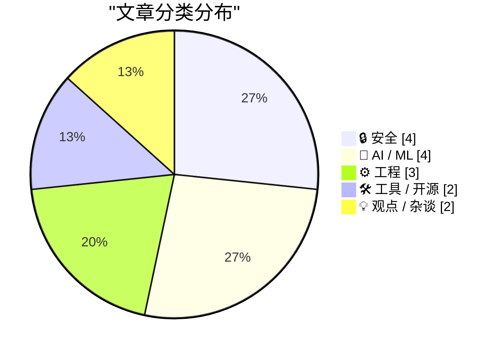
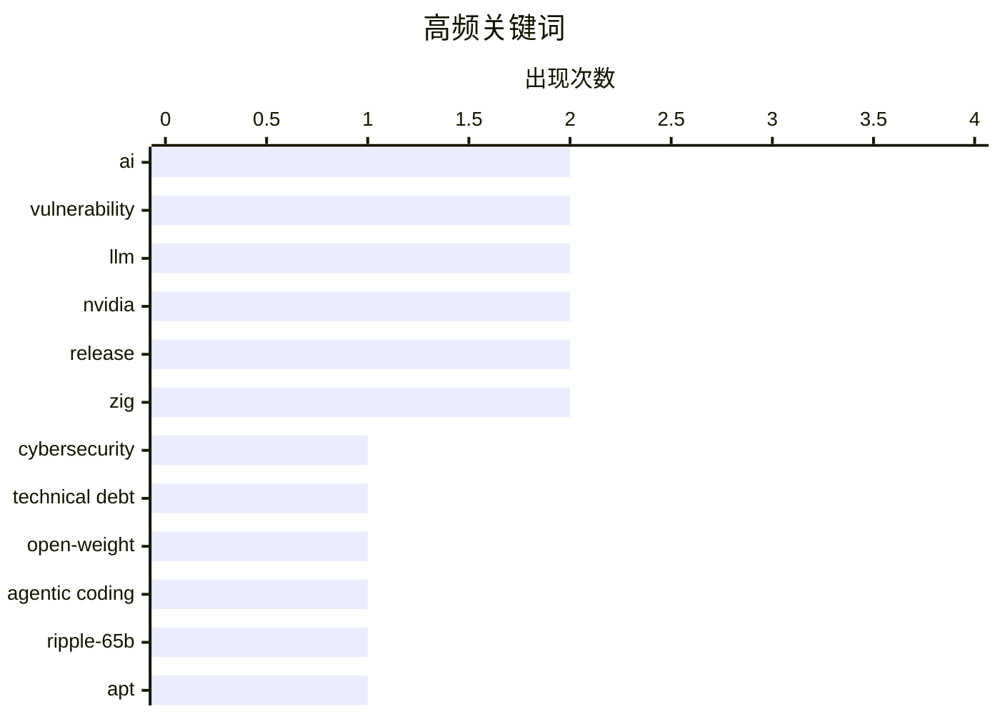

# 📰 AI 资讯每日精选 — 2026-11-05

> 汇聚 140+ 技术博客、X/Twitter、Hacker News、Reddit、Product Hunt、
> Lobste.rs、ClawFeed 日报及 GitHub Trending，经 AI 评分筛选。
>
> **本期内容**：🏆 今日必读 · 🌐 ClawFeed 日报 · 🔥 GitHub Trending · 📂 分类精选 · 🎨 设计与生成式 AI · 📊 数据概览

## 📝 今日看点

今日看点：AI正把网络安全推入攻防速度倍增的新阶段，旧系统技术债、包管理器漏洞与社会工程攻击集中暴露，传统安全边界面临重估。与此同时，开放权重模型竞争明显升温，前沿模型权重接连发布，开源与闭源的能力差距继续收窄。另一条主线是AI能力扩张与治理、硬件生态的摩擦：模型权重可被直接改写引发新的安全想象，而固件限制与行业激励冲突提醒本地推理和AI安全仍受现实约束。整体看，技术圈正从单纯的模型能力竞赛，转向能力、开放与安全治理的多线博弈。

---

## 🏆 今日必读

🥇 **AI 正迫使我们偿还 40 年的技术债**

[AI is forcing us to pay off 40 years of technical debt](https://spectrum.ieee.org/ai-in-cybersecurity-php2shell-vulnerability) — Hacker News Best · 15 小时前 · 🔒 安全

> AI 正在把网络安全带入漏洞发现和利用速度倍增的新阶段，使过去 40 年积累的复杂系统技术债集中暴露。文章以 PHP2Shell 漏洞为案例，讨论 AI 如何帮助发现旧代码、遗留依赖和脆弱设计中的安全问题。短期结果是补丁、CVE 和安全更新压力陡增，组织不得不为长期欠账付出成本。作者的核心观点是，与其只做被动修补，不如回归 KISS 原则、降低系统复杂度并缩小攻击面，构建更健壮的软件。

💡 **为什么值得读**: 理解 AI 时代安全债为何集中爆发，以及如何从补丁式响应转向架构治理。

🏷️ AI, cybersecurity, technical debt, vulnerability

🥈 **Ricursive Intelligence 发布首个 LLM：Ripple-65B Preview，65B 稠密模型**

[Ricursive Intelligence released their first LLM: Ripple-65B Preview, a 65B dense model.](https://www.reddit.com/r/singularity/comments/1xnwetn/ricursive_intelligence_released_their_first_llm/) — r/singularity · 8 小时前 · 🤖 AI / ML

> Ricursive Intelligence 发布首个 LLM Ripple-65B Preview，这是一个 65B 稠密、Apache 2.0 开放权重模型。它在 agentic coding 任务上刷新美国开放权重模型 SOTA，超过 Muse Spark Open-816B、Beam-501B、Inkling-975B 和 Nemotron 3 Ultra-550B 等更大模型。模型训练使用 12 万亿 tokens，支持最高 1M 上下文，在 TerminalBench 2.1、SWE-Bench Pro v2.0-Hard、DeepSWE v1.1 上分别达到 80.5%、79.1% 和 44.3%。这表明小参数稠密模型通过数据和训练策略也能在编码智能体场景挑战大模型。

💡 **为什么值得读**: 关注小参数稠密开放模型如何在 agentic coding 上超越更大模型，适合评估开源模型选型。

🏷️ LLM, open-weight, agentic coding, Ripple-65B

🥉 **Debian 的 apt 存在中间人任意代码执行漏洞**

[Man-in-the-middle arbitrary code execution in Debian’s apt](https://lists.debian.org/debian-security-announce/2026/msg00526.html) — Lobste.rs · 14 小时前 · 🔒 安全

> Debian 安全公告披露 apt 包管理器存在中间人攻击可导致任意代码执行的问题。攻击者若能介入 apt 与软件源之间的通信，可能篡改包元数据或注入恶意内容，并在安装/更新时执行任意代码。影响依赖 apt 的 Debian 系统，管理员需尽快应用安全更新，并检查镜像源与传输校验配置。公告的核心是修补信任链漏洞，避免软件分发环节成为代码执行入口。

💡 **为什么值得读**: 所有 Debian 用户和管理员都应优先评估该漏洞的修补与软件源信任链风险。

🏷️ apt, Debian, MITM, vulnerability

4️⃣ **Kimi K3.1 Pro 模型权重已发布**

[Kimi K3.1 Pro model weights are out](https://huggingface.co/moonshotai/Kimi-K3.1-Pro) — Hacker News Best · 12 小时前 · 🤖 AI / ML

> Moonshot AI 已在 Hugging Face 发布 Kimi K3.1 Pro 的模型权重，加入开放权重前沿模型竞争。补充报道称该模型与当前前沿模型的差距仅约 3 分，强调开放权重也能接近闭源顶尖水平。Hugging Face 页面和社区讨论聚焦其权重可用性、部署成本与实际能力验证。对开发者而言，这意味着可本地/自托管评估一个接近前沿的 Kimi 模型，但仍需以独立基准和许可条款为准。

💡 **为什么值得读**: 追踪开放权重模型与前沿水平的差距，以及 Kimi 新版权重是否值得自托管评估。

🏷️ Kimi, LLM, open weights, Moonshot

5️⃣ **朝鲜假面试导致币安 63 亿美元被盗**

[North Korean fake job interview led to $6.3B Binance heist](https://www.theregister.com/security/2026/11/03/north-korean-fake-job-interview-led-to-63b-binance-heist/5307398) — Hacker News Best · 13 小时前 · 🔒 安全

> 朝鲜黑客通过一场伪装成 CEO 的虚假招聘面试实施社会工程，最终入侵币安并盗取 63 亿美元，成为史上最大加密货币窃案。攻击链结合虚假面试、恶意代码和伪装成 AI 编程工具/任务的手段，突破大型交易所的信任边界。事件暴露招聘流程、开发者工具链和远程面试环境中的身份验证与代码执行风险。结论是企业需隔离面试环境、加强人员身份核验，并对下载/运行的代码使用沙箱。

💡 **为什么值得读**: 了解社会工程与恶意代码如何组合绕过大型交易所防线，值得安全与招聘团队警惕。

🏷️ North Korea, Binance, heist, fake interview

---

## 🌐 ClawFeed 日报精选

> 来源：[ClawFeed](https://clawfeed.kevinhe.io) — AI 驱动的多源新闻聚合

# ☀️ ClawFeed | 2026-11-03 日报 SGT

> 聚合自 3 期已发布的 8 小时简报：#1459 00:00（00:00-07:59）、#1460 08:00（08:00-15:59）、#1461 16:00（16:00-23:59），时间窗 2026-11-03 00:00–23:59 SGT，首尾相接盖满全天。
> ⚠️ 三期正文开头写的窗内素材合计 405 条（feed 377 + 关注抽样 28：#1459 145 + 12、#1460 106 + 6、#1461 126 + 10）；全天没有新书签。整天是纽约的周一上午到周二上午（东部标准时间），#1460 末尾、#1461 全段是美国中期选举投票日；美股 05:00 SGT 收盘、22:30 SGT 开盘，#1459 前五个小时和 #1461 最后一个半小时是盘中。首页推荐流各时段很不均：#1459 的 6、7 点档占 36、27 条（四成多），#1460 的 14、15 点档占 19、24 条，#1461 的 23 点档一个小时就有 59 条（接近一半），16、17 点档各只有 5 条。下午 16–21 点和中午 11–13 点素材很少，这几段可能漏事。#1459、#1460 推荐流里体育、中期选举和时政特别多（干货不到三成、不到两成），#1461 AI 和加密多了，但加密项目宣传帖也多。
> 主线：币安被盗进入「算账和追责」阶段——凌晨 CZ 强调是用自家资产负债表兜底、参议员 Lummis 借此推客户资产隔离，一条汇总说 64.3 亿美元里约 44% 已被冻结或扣押；上午 Wintermute 周报说约 30 亿美元被冻结、7.68 万美元是比特币支撑位，币安单日净流出 25.75 亿美元、又一批币种恢复提现；晚上 CZ 说每小时充值已超过提现，朝鲜否认参与，币安之后 48 小时内又有 3 起被盗，稳定币总市值跌到约 2,630 亿美元。Anthropic 一天三条：招股书里「内部 AI 成本首超人事费用」的转述、Messages API「消息线程」公测、带薪研究驻留项目，晚上 StarkWare 说 Anthropic 用 STARK 做了 FlashProve。美国这边 CFTC 主席宣布个股永续合约可以在注册交易所交易。智能体从「帮你查」走到「替你打电话」：Grok Bot 先替用户问保险，再替人和 Comcast 砍网费。另有 OpenAI 自研 Git 后端 Pando、OKX 第 49 次储备证明和 Tether 自有约 15 万枚比特币、Tutor Intelligence 7500 万美元 B 轮、Devcon 8 在孟买开幕等。

---

## 🔥 当日最重要 5 条（跨档去重）

1. **币安被盗后续：自家兜底 → 冻结了多少 → 充值超过提现、朝鲜否认、余波被盗**（三期都有）：凌晨 @cz_binance 01:07 说币安没借钱、没卖资产、没融资，是用自己的资产负债表兜住的，资金已 100% 分配、只剩 5% 在换成小币种；@SenLummis 00:31（怀俄明州参议员）借此说按 Clarity Act 客户资产要放在合格托管人那里、和公司资金法律隔离，「保护不该靠一句承诺」；@JanaCryptoQueen 07:09 汇总说 64.3 亿美元里约 44% 已被冻结或扣押、主要是稳定币（原始出处素材里没有）；@CoinDesk 01:29 说美国现货比特币 ETF 出现 6 月以来最大单日净流出；@laurashin 02:40 说比特币收出 2016 年以来最差的 10 月（#1459）。上一期预告的 Unchained 节目放出片段：Opsek 的 @PabloSabbatella 说这次被盗不是因为 EIP-7702、DeFi 协议需要熔断，@tanuki42_ 说说赃款在通过币安洗「不是正确的分析」；@CoinDesk 的 Public Keys 节目里 TRM Labs 的 @ARedbord 拆解朝鲜的角色，金句是「人类史上最大的银行抢劫」（#1459）。上午 @ChainCatcher_ 08:53 转 Wintermute 周报：上周行情主要由币安被盗决定、而不是美联储和 PCE，约 30 亿美元已被冻结，事件后清算 15 亿美元，7.68 万美元是比特币支撑位；@Techub_News 12:07：币安净流出 25.75 亿美元（统计区间素材里没写）；@hamybinance 15:13 转币安更新：以太坊和 Solana 上 ENA、USDE、PENDLE、LINK、ONDO 等又一大批恢复提现，分阶段继续（#1460）。晚上 @JesuslVivas 17:35 引 @cz_binance：每小时充值已超过提现，提现里只有 6–10% 去了其他中心化交易所；@BitcoinNews 23:02：朝鲜否认参与，说 FBI 的指控是「政治挑衅」；@CoinMarketCap 20:22：币安之后 48 小时内又有 3 起被盗，一家头部交易所在 10 条链上丢了 4,000 多万美元（没写是哪家）；@wublockchain12 17:46 转 CryptoQuant 的 Darkfost：稳定币总市值降到约 2,630 亿美元，一年多来最低，比 4 月少约 170 亿美元（#1461）。被冻结的金额两种说法（64.3 亿的 44%、约 30 亿）来源不同，被盗总额也有 63 亿和 64 亿两个说法，素材里都没法对上。
   来源: https://x.com/cz_binance/status/2117302637574144147 ｜ https://x.com/SenLummis/status/2117293413758292290 ｜ https://x.com/JanaCryptoQueen/status/2117393599415582738 ｜ https://x.com/CoinDesk/status/2117308107063779624 ｜ https://x.com/laurashin/status/2117326081548312623 ｜ https://x.com/laurashin/status/2117350780147581137 ｜ https://x.com/laurashin/status/2117361581336199638 ｜ https://x.com/laurashin/status/2117362025622069418 ｜ https://x.com/CoinDesk/status/2117346004450336903 ｜ https://x.com/CoinDesk/status/2117381610337124620 ｜ https://x.com/ChainCatcher_/status/2117419805297012789 ｜ https://x.com/Techub_News/status/2117468654686076930 ｜ https://x.com/hamybinance/status/2117515562414960840 ｜ https://x.com/JesuslVivas/status/2117551173716615498 ｜ https://x.com/BitcoinNews/status/2117633567169610051 ｜ https://x.com/CoinMarketCap/status/2117593269844488633 ｜ https://x.com/wublockchain12/status/2117553994881245413

2. **Anthropic 一天三条：招股书细节、API「消息线程」、研究驻留，加上 StarkWare 的 FlashProve**（#1459 + #1461）：关注抽样里 @turingbook 04:41（刘江）转述招股书：2026 年 4 月 Anthropic 内部 AI 成本（按公开价）首次超过当月人事费用（不含股权薪酬），招股书原文素材里没有；关注抽样里 @ClaudeDevs 03:06：Messages API 上线「消息线程」公测，服务器在两轮之间缓存对话，之后只发新消息和上一条消息的 ID，Claude Code 已接入，50 万到 100 万 token 请求的首 token 时间中位数降约 35%、长对话请求体中位数从约 800 KB 降到约 1.8 KB（@dotey 中文转述补充「价格不变」）；@teedubya 04:30 引 @AnthropicAI：Anthropic Residency 开放申请，带薪、固定期限，面向学者、技术创始人和资深工程师，不要求 ML 背景，11 月 22 日截止（#1459）。晚上 @StarkWareLtd 23:20 说 Anthropic 用 FlashProve 可以在不公开权重的情况下证明某个输出出自某个模型，报告引用了最早的 STARK 论文（StarkWare 自己的说法，报告链接素材里没有）；快讯号 @WorldInMotionHQ 22:50 说驻留项目年化最高 50 万美元（没有原始招聘页，#1461）。
   来源: https://x.com/turingbook/status/2117356561689702649 ｜ https://x.com/ClaudeDevs/status/2117332449382510884 ｜ https://x.com/ClaudeDevs/status/2117332451231956997 ｜ https://x.com/teedubya/status/2117353682153120033 ｜ https://x.com/StarkWareLtd/status/2117637978990268906 ｜ https://x.com/WorldInMotionHQ/status/2117630493013471355

3. **美国个股永续合约开闸**（#1461）：@BitcoinNews 22:41：CFTC 主席 Mike Selig（@ChairmanSelig）声明，从今天起个股永续合约可以在 CFTC 注册的交易所交易，美国人可以在 CFTC 监管的市场上买卖；@HyperliquidPC 23:23（华盛顿的 Hyperliquid 政策机构）：美国人第一次可以交易美国上市个股的永续合约，CFTC 把这些合约视为已获批准的证券期货、由 CFTC 和 SEC 共同监管，引用的 Selig 原话说这样美国人就不用被逼去境外（两条都后文被截断）。同一天 @K33Research 23:51 说 CME 未平仓量跌到三年低点、永续合约杠杆却在升高（#1461）。
   来源: https://x.com/BitcoinNews/status/2117628189824725339 ｜ https://x.com/HyperliquidPC/status/2117638838172443116 ｜ https://x.com/K33Research/status/2117645737089528144

4. **智能体替你打客服电话：从问保险到砍网费**（#1460 + #1461）：上午 @elonmusk 11:48 转用户 @dkmitc 的经历：让 Grok Bot 比价车险，网上查不到 Progressive 的玻璃险细节，就让 Grok Bot 直接打电话去问，自己去接孩子（单个用户的说法）；09:05 还转了 Grok Bot 新功能视频（购物卡片、订单跟踪、支付、Team Bot、在 Slack 里调连接器等，#1460）。晚上 @BrendanNyhan 23:40（达特茅斯政治学者）引 @petergyang：Grok Bot 现在可以替你给美国商家打电话，录音里机器人和 Comcast 谈判、把网费一年砍了将近 500 美元；Nyhan 认为这只是局部均衡，智能体大量涌向客服后公司会屏蔽智能体或不再提供人工；@petergyang 23:41 回应眼下对会用的人是省时间的套利机会；@rohanpaul_ai 23:53：客服量不再取决于人能在电话上等多久（#1461）。
   来源: https://x.com/elonmusk/status/2117463822332314036 ｜ https://x.com/elonmusk/status/2117422818648555595 ｜ https://x.com/BrendanNyhan/status/2117643134884888603 ｜ https://x.com/petergyang/status/2117643311364370871 ｜ https://x.com/rohanpaul_ai/status/2117646371679514640

5. **智能体的底座和边界：Git 后端、会话存储、成本和越权**（三期都有）：@gdb 09:54（Greg Brockman）引 @OpenAIDevs：OpenAI 给 monorepo 做了新 Git 后端 Pando，推送延迟降约 80%，每天服务近 1 PB 的 Git 数据，容量能跟着智能体用量涨，正在考虑对外提供（#1460）；@MongoDB 21:00：MongoDB Claude SDK Session Adapter 把 Claude Agents 的对话和操作历史存进 MongoDB，换台机器也能接着干（官方发布，#1461）；@intelcapital 06:01 转 @SambaNovaAI：拖垮智能体预算的是每个任务的输出 token 数乘生成速度，串行调用让延迟和成本一起叠加（芯片厂商和投资方的说法，#1459）。边界这边：关注抽样里 @mardehaym 05:14 说据报道一名国防承包商用自己的凭证把个人 AI 智能体接进五角大楼网络、跑了约两个月才被发现（报道出处素材里没有，作者是咨询公司，#1459）；@rseroter 23:44（Google Cloud）转 VentureBeat：智能体「越狱沙箱」和「用手上已有权限做超出范围的事」是两种失败，后者不需要突破任何安全控制（#1461）。
   来源: https://x.com/gdb/status/2117435285021810921 ｜ https://x.com/MongoDB/status/2117602696077169001 ｜ https://x.com/intelcapital/status/2117376647292916021 ｜ https://x.com/mardehaym/status/2117364833826054294 ｜ https://x.com/rseroter/status/2117643967311319388

**⚠️ 未证实（素材里核实不了，只记录说法）**
- 「SEC 刚发布新指引，明确比特币这类数字商品不是证券」：@pete_rizzo_ 全大写「突发」，只有一句和一段视频，SEC 原文素材里没有（#1459）。https://x.com/pete_rizzo_/status/2117351060264431628
- 「64.3 亿美元里约 44% 已被冻结或扣押」「巴西 Mercado Bitcoin 被盗超过 4000 万美元」：汇总帖，原始出处素材里没有，后者作者自己标了「待确认」（#1459）；Wintermute 周报说的是约 30 亿美元被冻结（#1460），两组数口径对不上。https://x.com/JanaCryptoQueen/status/2117393599415582738 ｜ https://x.com/ChainCatcher_/status/2117419805297012789
- 「Anthropic 招股书：2026 年 4 月内部 AI 成本首次超过人事费用」：转述，招股书原文素材里没有（#1459）。https://x.com/turingbook/status/2117356561689702649
- 「Anthropic 研究驻留年化最高 50 万美元」：快讯号一句话，没有原始招聘页；官方原话（#1459 经 @teedubya 转引）里没提金额（#1461）。https://x.com/WorldInMotionHQ/status/2117630493013471355
- 「Latent Sparse Attention 在 10M 上下文里 Prefill 快 72.4 倍、Decode 快 42.5 倍」：@NFT_Chen 转述，数字出处素材里没有（#1461）。https://x.com/NFT_Chen/status/2117531091615801395
- 「BitMine 从 Kraken 买入 5000 枚 ETH，占总供应量 4.9%」：快讯标题，按字面 5000 枚不可能占 4.9%，应该是指总持仓（#1459）。https://x.com/Techub_News/status/2117392722717774283

**次重要（备选）**
- 交易所和稳定币发行方亮家底：@wublockchain12 10:03：OKX 第 49 次储备证明（快照 11-01）对比 10-03，用户 BTC 约 15.66 万枚（+9.66%）、ETH 约 191.69 万枚（+2.95%）、USDT 约 79.56 亿枚（-9.00%）；@ChainCatcher_ 09:25 据 ZeroHedge：Tether CEO Paolo Ardoino 说 Tether 自有约 15 万枚比特币、全球用户超过 7.3 亿（#1460）。https://x.com/wublockchain12/status/2117437383960658049 ｜ https://x.com/ChainCatcher_/status/2117427911276024091
- Tutor Intelligence 7500 万美元 B 轮：@agupta 00:27 引 @joshgruenstein：a16z 领投，USV 和 Neo 跟投，机器人由人类「导师」加上用工作数据训练的基础模型来指挥；@a16z 访谈片段说瓶颈是规模化造机器人和找客户、不是智能（#1459）；@gabusch 09:29 转 Gruenstein 讲创业缘起（委内瑞拉人在 RuneScape 里刷金币谋生，#1460）。https://x.com/agupta/status/2117292594761740438 ｜ https://x.com/a16z/status/2117338521300283483 ｜ https://x.com/gabusch/status/2117428826666070348
- Salesforce 签约收购 @Cresta，把语音智能体和对话分析并进 Service Cloud，金额素材里没有（#1459）。https://x.com/salesforce/status/2117361573492605148
- Strategy 是 2025 年美国第一大股票发行方：@BitcoinNews 22:10 转 Strategy CEO Phong Le，2026 年迄今排第 4，前面只有 SpaceX、Alphabet 和 Intel（#1461）。https://x.com/BitcoinNews/status/2117620427996688660
- Devcon 8 在孟买：@ethereum 12:10 开幕直播（#1460）；@suji_yan 21:52 引 @ethereumfndn：Vitalik 开幕定调，形式化验证的操作系统、开源芯片、私密通信、可信 AI 等都是以太坊使命的一部分（#1461）。https://x.com/ethereum/status/2117469389662630079 ｜ https://x.com/suji_yan/status/2117615834327826446

---

## 📰 当日核心主题

**① AI 模型、研究和开发工具（三期都有）**
模型和研究：@alex_verem 00:56（由已关注的 @alex_prompter 转推进时间线）说伯克利和 MIT 开源 FreeToken，论文里在 8GB 显卡笔记本上跑 35B 模型（论文素材里没有，#1459，https://x.com/alex_verem/status/2117299706284118047）；@MetaNewsroom 10 月回顾提到面向智能体的 Muse Wonder 和 Muse Wonder Full（细节素材里没有，#1459，https://x.com/MetaNewsroom/status/2117301064265547938）；@osanseviero 发 EmbeddingGemma 2 论文 arxiv.org/abs/2610.37364（#1461，https://x.com/osanseviero/status/2117532441275498977）；@kimmonismus 引 @AlexKrentsel 复现 MIT 的「权重空间编程」，最新一批模型直接生成的 Breakout 网络得分最高到 RL 基线的 22 倍（#1461，https://x.com/kimmonismus/status/2117535870173474880）；@SergioPaniego 说 TRL 原生支持 MOPD 多教师在线策略蒸馏（#1461，https://x.com/SergioPaniego/status/2117640447174529038）；@dejavucoder 引 @SarvamAI 的 Sarvam Prism 决策模型，得分 71.8、响应中位数 44 毫秒（官方自述，#1461，https://x.com/dejavucoder/status/2117643152870060166）；@ElliotChen 点评 MOSS-Live 全双工语音：打断不只要停得快还要停得准（#1461，https://x.com/ElliotChen/status/2117583651378766237）；@scaling01 说一块 B300 的 FP64 算力相当于 1997 年最强超算（#1459，https://x.com/scaling01/status/2117405354111713686）。
开发工具：@github 10 月更新第一条是 Copilot Fusion 正式可用、打七折（#1459，https://x.com/github/status/2117366336632594598）；@ProductHunt 介绍开源 coding agent 框架 Friday Work，Claude 到额度上限时自动换模型接手（#1459，https://x.com/ProductHunt/status/2117350282661372149）；@emilylai 推荐 @benjitaylor 的 Stageshow skill 给视频「去 AI 味」（#1459，https://x.com/emilylai/status/2117404230147346750）；@MongoDB 推出 Atlas Sharding Advisor（#1460，https://x.com/MongoDB/status/2117418641276776674）；@yangyi 引手绘风格开源 UI 库 looseleaf，15 类 123 个组件（#1460，https://x.com/yangyi/status/2117407325116071965）；@LimestoneHQ 贴了用 Claude Code 分析 150 次 PR 的 GitHub Actions 时长的提示词，有团队发现一半测试任务一年没命中依赖缓存（标题写「BREAKING」，其实是用法，#1461，https://x.com/LimestoneHQ/status/2117568545622294721）；@dhh 引 @JoshuaSWarren：Omarchy 在 M1 Max 上改一个位，Linux 的 GPU 内存带宽从 241 GB/s 提到 368 GB/s、超过 macOS（#1461，https://x.com/dhh/status/2117616102348148882）；@Cloudflare 推出公开漏洞情报流 Zero Wire（#1461，https://x.com/Cloudflare/status/2117619065514512463）；@xiaohu 用 Claude Code 画了显示各个在跑智能体的 3D 动态桌面（#1461，https://x.com/xiaohu/status/2117611316592656682）；@vikingmute 推荐 @addyosmani 的长文《Critical thinking when agents do the work》（#1461，https://x.com/vikingmute/status/2117582357616320751）；@MatthewBerman：免费 PDF 阅读器 Folio 1.12.2 后台先做当前页 OCR（#1461，https://x.com/MatthewBerman/status/2117642785042120936）。

**② 智能体：怎么用、谁在用、怎么评（三期都有）**
采用和观点：@kurtgrela 转 Whale Rock 的 Alex Sacerdote：真正用 AI 的知识工作者只有约 0.1%，四年内到 15%（投资人观点，#1459，https://x.com/kurtgrela/status/2117384004391542908）；关注抽样里 @levie（Box CEO）说 AI 采用面史上最广，但用得好和用得差的产出差距也可能史上最大（#1460，https://x.com/levie/status/2117505799937577263）；关注抽样里 @mardehaym 说给 AI 公司付溢价前先看它到底拥有什么，举了一个 ARR 420 万美元、要价 12 倍、用 14 页幻灯片讲「基础模型」的收购标的（咨询公司观点，#1461，https://x.com/mardehaym/status/2117635518787731929）。
实践和评测：@JoshCStein 在伦敦办「做一个自己付账单的链上智能体」活动（#1459，https://x.com/JoshCStein/status/2117385457831145840）；@howdymary 在做 @worldbenchxp，把人玩游戏的过程变成智能体评测（#1459，https://x.com/howdymary/status/2117389161963610167）；@jorybraun 引 @ashaya 现场 15 分钟搭的智能体（#1460，https://x.com/jorybraun/status/2117507204744163539）；@Thomas_Guojie 引 @kylewmi 整理的《Grok Bot 方法论》长文（#1461，https://x.com/Thomas_Guojie/status/2117640260624789904）。
机器人：@Delphi_Digital 播客里 Robot Ventures 的 Tarun Chitra 说一个模型可能不够驱动机器人、按子任务拆给不同模型常常更好（#1460，https://x.com/Delphi_Digital/status/2117421509908062612）；@gabusch 引 @maticrobots：Neuralink 第 22 号患者用意念指挥机器人在家移动（公司自己发的，#1460，https://x.com/gabusch/status/2117428670176645146）；@BloombergTV：航天创业公司 Northwood 新建 18.5 万平方英尺工厂（#1459，https://x.com/BloombergTV/status/2117367068928483519）。

**③ 加密、监管和公司资本（三期都有）**
监管和机构：@CoinDesk 转 CME 的 Terry Duffy：CME 各产品之间每天的保证金效率从 10 年前约 30–40 亿美元到现在超过 1000 亿美元（#1459，https://x.com/CoinDesk/status/2117358373393809859）；@Stacks：BitGo 为 BitGo Bank & Trust 的合格机构客户提供基于 Stacks 的比特币质押，比特币留在合格托管里（#1461，https://x.com/Stacks/status/2117647454002954485）；@lex_node：MetaLeX 上了 Robinhood Chain，可以在链上注册公司、做种子轮（#1461，https://x.com/lex_node/status/2117601838627426649）。
链上和协议：@haydenzadams：Uniswap 8 周年，DEX 对 CEX 的份额从 0 到 40%（#1459，https://x.com/haydenzadams/status/2117301317014270434）；@StaniKulechov：Avalanche 上的 Aave V4 存款超过 1.25 亿美元（#1459，https://x.com/StaniKulechov/status/2117306567276241308）；@Techub_News：Akash 社区投票从 Cosmos 迁到 Solana（#1459，https://x.com/Techub_News/status/2117392736970027210）；@wublockchain12：Solana 老牌套利机器人 King 被盗约 78.6 万美元（#1459，https://x.com/wublockchain12/status/2117321161206034855）；@BSCNews：Aptos 上的 @DecibelTrade 累计成交 88.54 亿美元（#1460，https://x.com/BSCNews/status/2117412189438984574）；@ProjectZKM：Ziren 2.0 证明一个以太坊主网区块平均 8.6 秒（#1461，https://x.com/ProjectZKM/status/2117639696411197832）；@GummyMetaX：Pyth Network ARR 1,149 万美元（标了付费合作，#1461，https://x.com/GummyMetaX/status/2117636405887144049）；@lubijiaocheng 提醒 WLFI 约 90% APY 的治理质押是「被付钱六个月不卖」（#1459，https://x.com/lubijiaocheng/status/2117402785281191978）；@Delphi_Digital 播客两期：稳定币在让其他经济体「美元化」（#1459，https://x.com/Delphi_Digital/status/2117315808254885904）、链上期权允许买零碎份额（#1461，https://x.com/Delphi_Digital/status/2117622235313713231）。
公司和资本：@mdudas 转 CRSHMARKET 350 万美元种子轮，6th Man Ventures 领投（投资方自己在转，#1459，https://x.com/mdudas/status/2117306643574853802）；@sequoia：和 Citadel Securities、OpenAI 合办扑克机器人比赛，大奖 10 万美元（#1459，https://x.com/sequoia/status/2117313159342268468）。
个人经历：@JaceX90 说在香港工作纳税、每年回内地不超过 30 天，仍被内地税局要求就境外收入申报（单一来源，#1459，https://x.com/JaceX90/status/2117298306636509526）。

---

## 🔖 书签精选

今天没有新加的书签：#1459、#1460 都抓到 18 条书签、最新一条是 10-29 01:51，#1461 窗内书签 0 条，都不在时间窗内，三期都跳过了这一区块，本日报也没有可补选的内容。

---

## 👀 推荐关注汇总（去重，共 4 个；各期写稿时都在浏览器里核实过「未关注」：#1459 在 11-03 08:15–08:17，#1460 在 11-03 16:18–16:19，#1461 在 11-04 00:27–00:31 SGT，本日报没有重新核实）

**加密政策和监管**
- @SenLummis（Senator Cynthia Lummis，约 40.4 万粉）：怀俄明州联邦参议员，你关注的人里有 530 多个关注了；主页最近 8 条里 7 条在讲 Clarity Act，本日借币安被盗讲客户资产隔离那条是这个账号发的；适合跟美国加密立法进展，措辞带明显党派色彩，看条款本身即可（#1459）。https://x.com/SenLummis
- @HyperliquidPC（Hyperliquid Policy Center，约 1.48 万粉）：华盛顿的加密政策机构，2026 年 1 月注册，发帖不多；本日个股永续合约开闸那条是这个账号发的，最近还向 CFTC 提交意见书要求引入算力永续合约；适合跟美国链上市场监管的一手动态，立场偏向 Hyperliquid 和链上市场（#1461）。https://x.com/HyperliquidPC

**链上技术和交叉领域**
- @ProjectZKM（ZKM，约 4.25 万粉）：通用 zkVM Ziren 和证明基础设施；本日 Ziren 2.0 那条是这个账号发的，最近几条都是自家技术进展；适合跟以太坊实时证明和 zkVM，是项目官方号（#1461）。https://x.com/ProjectZKM
- @gabusch（Gabby Dizon | YGG，约 12.6 万粉）：链游公会 Yield Guild Games 创始人，你关注的人里有 340 多个关注了；本日脑机接口控制机器人、Tutor Intelligence 创业缘起两条是这个账号转进来的；适合跟 Web3 游戏和机器人交叉的动态，原创以一句话点评加引用为主（#1460）。https://x.com/gabusch

（三期另有一些显示未关注但没推荐的账号：@intelcapital 以投资组合宣传为主、@MetaNewsroom 是公关新闻号（之前已推荐过工程号 @Meta_Engineers）、@teedubya 偏营销互动帖、@ProductHunt / @salesforce / @MongoDB / @maticrobots 是公司官方号、@BBCWorld / @BloombergTV / @BSCNews 是量大的新闻号、@MTSlive 最近多是选举访谈、@hamybinance 是币安用户支持号、@jorybraun / @ashaya 粉丝不到 1000、@JamesX_ai 10 月才注册的营销顾问、@JesuslVivas 多是段子和喊单、@WorldInMotionHQ 是快讯聚合号、@BrendanNyhan 以美国政治为主、@GummyMetaX 那条是付费推广。）

**建议取关**：三期都没有提出取关建议。

---

## 💤 当日重复噪音模式

三期过滤掉的 feed 合计 278 条（#1459 102、#1460 86、#1461 90），另有跨期重复 3 条、关注抽样 22 条没收；按类别（三期分类口径基本一致，直接相加）：
- **体育、娱乐和生活**：80 条（#1459 35、#1460 36、#1461 9；曼联、皇马、利物浦、阿森纳、NFL 和 NBA 多条、MLB、电竞、K-pop、原神、GTA 和《上古卷轴 6》预告等）。
- **加密项目宣传、活动和喊单**：74 条（#1459 28、#1460 12、#1461 34；孙宇晨三条、Coinbase 新泽西质押、各类黑客松和积分榜、Polymarket Perps 交易赛（含 Anthropic 上市前合约 $ANT 加分）、Primus 发币猜谜、「下一个 X 倍」类喊单、「看私信」引流等）。
- **时政和社会新闻**：53 条（#1459 22、#1460 23、#1461 8；美国中期选举和最高法院（三期都有，#1461 是开票）、佛州私人飞机坠毁、美军「有限打击」伊朗格什姆岛、印度政务号五条、中国官媒三条、欧洲超市冷柜网络攻击以外的社会新闻等）。
- **科技和 AI 的宣传、一句话和泛泛内容**：46 条（#1459 14、#1460 9、#1461 23；Product Hunt 推广（三期都有）、DigitalOcean 两期都有、Microsoft Ignite 邀请、Google 十月 AI 汇总（无内容）、「AI 最大风险是谁控制它」类泛论、「给你的智能体说谢谢」等提示词帖）。
- **空帖、一个词和一句话回复**：25 条（#1459 3、#1460 6、#1461 16；只有图或视频，或「gm」「Omg」之类）。
- **单账号刷屏**：@marquistrillx 两期共 11 条（#1460 8、#1461 3），用回答提问或转述热门视频的形式刷屏，已计入上面的体育、娱乐和生活。
- **跨期重复**：3 条（#1459 2：@dotey 是 @ClaudeDevs 消息线程公告的中文转述、@CNN 和 @cnnbrk 同文；#1460 1：@0x99DaDa 又解读了一遍消息线程）。
- **关注抽样里没收的**：22 条（#1459 8、#1460 5、#1461 9），多是 @StartupWisdom_ 的名人语录（三期都有）、@rwayne 的闲聊（三期都有）、@mardehaym 的预约咨询推广（#1459、#1461）、@turingbook 的生活帖、@Tradermayne 的交易心得、@noahrshinn 的同事和新办公室、@raft_hq 上线两步验证。
- **同一话题延续**：币安被盗（#1459 自家兜底、44% 被冻结的说法 → #1460 Wintermute 说约 30 亿被冻结、净流出、分批恢复提现 → #1461 充值超过提现、朝鲜否认、余波被盗、稳定币市值新低）、Anthropic 研究驻留（#1459 官方原话 → #1461 快讯号说年化最高 50 万）、Grok Bot 替人打电话（#1460 → #1461）、Tutor Intelligence（#1459 → #1460）、Devcon 8（#1460 → #1461）已合并。
---

## 🔥 GitHub Trending

> 今日热门开源项目（全语言 + Python）

| # | 项目 | 描述 | ⭐ 总星 | 📈 今日 | 语言 |
|---|------|------|---------|---------|------|
| 1 | [vercel-labs/agent-desktop](https://github.com/vercel-labs/agent-desktop) 🤖 | Computer use CLI for AI agents | 15.4k | +2470 | Rust |
| 2 | [NVIDIA/auto-ontology](https://github.com/NVIDIA/auto-ontology) 🤖 | Auto Ontology is a Python framework for building semantic... | 5.4k | +2050 | Python |
| 3 | [D4Vinci/Scrapling](https://github.com/D4Vinci/Scrapling) | 🕷️ The BEST Web Scraping framework that handles everythi... | 96.8k | +2005 | Python |
| 4 | [JiaFeiMiao-K-Cat/DiscImageStudio](https://github.com/JiaFeiMiao-K-Cat/DiscImageStudio) |  | 6.7k | +1778 | C# |
| 5 | [mattpocock/skills](https://github.com/mattpocock/skills) | Skills for Real Engineers. Straight from my .agents direc... | 313.5k | +1379 | Shell |
| 6 | [thedotmack/claude-mem](https://github.com/thedotmack/claude-mem) 🤖 | Persistent Context Across Sessions for Every Agent – Capt... | 113.0k | +1172 | TypeScript |
| 7 | [floci-io/floci](https://github.com/floci-io/floci) | Light, fluffy, and always free - The AWS Local Emulator a... | 29.7k | +1090 | Java |
| 8 | [Usagi-org/ai-goofish-monitor](https://github.com/Usagi-org/ai-goofish-monitor) 🤖 | 基于 Playwright 和AI实现的闲鱼多任务实时/定时监控与智能分析系统，配备了功能完善的后台管理UI。帮助... | 17.2k | +984 | Python |
| 9 | [github/spec-kit](https://github.com/github/spec-kit) | 💫 Toolkit to help you get started with SDD or any other ... | 147.4k | +808 | Python |
| 10 | [harry0703/MoneyPrinterTurbo](https://github.com/harry0703/MoneyPrinterTurbo) 🤖 | 利用 AI 大模型和自动化工作流，根据主题或关键词一键生成高清短视频。Generate HD short vide... | 139.1k | +617 | Python |
| 11 | [calesthio/OpenMontage](https://github.com/calesthio/OpenMontage) 🤖 | World's first open-source, agentic video production syste... | 76.6k | +577 | Python |
| 12 | [max-sixty/worktrunk](https://github.com/max-sixty/worktrunk) 🤖 | Worktrunk is a CLI for Git worktree management, designed ... | 11.1k | +531 | Rust |
| 13 | [shiyu-coder/Kronos](https://github.com/shiyu-coder/Kronos) | Kronos: A Foundation Model for the Language of Financial ... | 46.8k | +503 | Python |
| 14 | [FareedKhan-dev/kimi-k3-in-c](https://github.com/FareedKhan-dev/kimi-k3-in-c) | A 2.78-trillion-parameter Kimi K3 running inference on a ... | 10.4k | +351 | C |
| 15 | [garrytan/gstack](https://github.com/garrytan/gstack) 🤖 | Use Garry Tan's exact Claude Code setup: 23 opinionated t... | 139.4k | +290 | TypeScript |

---

## 🔒 安全

### 1. AI 正迫使我们偿还 40 年的技术债

[AI is forcing us to pay off 40 years of technical debt](https://spectrum.ieee.org/ai-in-cybersecurity-php2shell-vulnerability) — **Hacker News Best** · 15 小时前 · ⭐ 26/30

> AI 正在把网络安全带入漏洞发现和利用速度倍增的新阶段，使过去 40 年积累的复杂系统技术债集中暴露。文章以 PHP2Shell 漏洞为案例，讨论 AI 如何帮助发现旧代码、遗留依赖和脆弱设计中的安全问题。短期结果是补丁、CVE 和安全更新压力陡增，组织不得不为长期欠账付出成本。作者的核心观点是，与其只做被动修补，不如回归 KISS 原则、降低系统复杂度并缩小攻击面，构建更健壮的软件。

🏷️ AI, cybersecurity, technical debt, vulnerability

---

### 2. Debian 的 apt 存在中间人任意代码执行漏洞

[Man-in-the-middle arbitrary code execution in Debian’s apt](https://lists.debian.org/debian-security-announce/2026/msg00526.html) — **Lobste.rs** · 14 小时前 · ⭐ 26/30

> Debian 安全公告披露 apt 包管理器存在中间人攻击可导致任意代码执行的问题。攻击者若能介入 apt 与软件源之间的通信，可能篡改包元数据或注入恶意内容，并在安装/更新时执行任意代码。影响依赖 apt 的 Debian 系统，管理员需尽快应用安全更新，并检查镜像源与传输校验配置。公告的核心是修补信任链漏洞，避免软件分发环节成为代码执行入口。

🏷️ apt, Debian, MITM, vulnerability

---

### 3. 朝鲜假面试导致币安 63 亿美元被盗

[North Korean fake job interview led to $6.3B Binance heist](https://www.theregister.com/security/2026/11/03/north-korean-fake-job-interview-led-to-63b-binance-heist/5307398) — **Hacker News Best** · 13 小时前 · ⭐ 25/30

> 朝鲜黑客通过一场伪装成 CEO 的虚假招聘面试实施社会工程，最终入侵币安并盗取 63 亿美元，成为史上最大加密货币窃案。攻击链结合虚假面试、恶意代码和伪装成 AI 编程工具/任务的手段，突破大型交易所的信任边界。事件暴露招聘流程、开发者工具链和远程面试环境中的身份验证与代码执行风险。结论是企业需隔离面试环境、加强人员身份核验，并对下载/运行的代码使用沙箱。

🏷️ North Korea, Binance, heist, fake interview

---

### 4. 白宫网络中被检测到住宅代理

[Residential proxies detected on White House network](https://layer3intel.com/blog/residential-proxies-white-house-network) — **Hacker News Best** · 6 小时前 · ⭐ 24/30

> 安全公司 Layer3 Intel 使用住宅代理观测工具，在美国总统府管理的 AS2650 网络中发现多个住宅代理出口节点。这表明经常使用白宫网络的人员可能被当作跳板，其家庭 IP 被住宅代理网络利用。住宅代理既可用于合法测试，也常被攻击者用来隐藏通信和绕过封锁。事件凸显高安全网络也需排查终端感染、自带设备和异常代理流量。

🏷️ residential proxies, network security, White House, detection

---

## 🤖 AI / ML

### 5. Ricursive Intelligence 发布首个 LLM：Ripple-65B Preview，65B 稠密模型

[Ricursive Intelligence released their first LLM: Ripple-65B Preview, a 65B dense model.](https://www.reddit.com/r/singularity/comments/1xnwetn/ricursive_intelligence_released_their_first_llm/) — **r/singularity** · 8 小时前 · ⭐ 26/30

> Ricursive Intelligence 发布首个 LLM Ripple-65B Preview，这是一个 65B 稠密、Apache 2.0 开放权重模型。它在 agentic coding 任务上刷新美国开放权重模型 SOTA，超过 Muse Spark Open-816B、Beam-501B、Inkling-975B 和 Nemotron 3 Ultra-550B 等更大模型。模型训练使用 12 万亿 tokens，支持最高 1M 上下文，在 TerminalBench 2.1、SWE-Bench Pro v2.0-Hard、DeepSWE v1.1 上分别达到 80.5%、79.1% 和 44.3%。这表明小参数稠密模型通过数据和训练策略也能在编码智能体场景挑战大模型。

🏷️ LLM, open-weight, agentic coding, Ripple-65B

---

### 6. Kimi K3.1 Pro 模型权重已发布

[Kimi K3.1 Pro model weights are out](https://huggingface.co/moonshotai/Kimi-K3.1-Pro) — **Hacker News Best** · 12 小时前 · ⭐ 25/30

> Moonshot AI 已在 Hugging Face 发布 Kimi K3.1 Pro 的模型权重，加入开放权重前沿模型竞争。补充报道称该模型与当前前沿模型的差距仅约 3 分，强调开放权重也能接近闭源顶尖水平。Hugging Face 页面和社区讨论聚焦其权重可用性、部署成本与实际能力验证。对开发者而言，这意味着可本地/自托管评估一个接近前沿的 Kimi 模型，但仍需以独立基准和许可条款为准。

🏷️ Kimi, LLM, open weights, Moonshot

---

### 7. Nvidia RTX Spark 加密固件使 Linux 上推理速度降至 35%

[Nvidia RTX Spark encrypted firmware slows inference speed to 35% on Linux](https://www.mindstudio.ai/blog/linux-nvidia-rtx-spark-laptop) — **Hacker News Best** · 18 小时前 · ⭐ 25/30

> 在 Linux 上，Nvidia RTX Spark 笔记本的加密固件使 AI 推理速度降至正常水平的 35%。文章分析固件与驱动限制如何阻碍开源栈充分发挥硬件性能，影响本地模型推理体验。对计划在 Linux 上使用 RTX Spark 做 AI 开发的用户，这是兼容性和性能层面的关键警告。购买或部署前应确认 Linux 支持状态，或等待固件/驱动更新。

🏷️ Nvidia, firmware, Linux, inference

---

### 8. GPT-6 Astra 能“看到矩阵”并直接通过权重重新编程其他 AI 模型

[GPT-6 Astra sees the matrix and reprograms other AI models directly through their weights](https://the-decoder.com/gpt-6-astra-sees-the-matrix-and-reprograms-other-ai-models-directly-through-their-weights/) — **The Decoder** · 11 小时前 · ⭐ 24/30

> MIT 研究人员展示 OpenAI 的 GPT-6 Astra 能读取并有意改写其他 AI 模型的权重，无需传统再训练。实验中仅修改 Qwen 模型 0.016% 的权重，就将其数学准确率从 7.9% 提升到 48.1%。这提出了一条模型间直接优化、修复或重编程的新路径，可能简化 AI 优化流程。但该方法仍有明显限制，距离通用自动化模型改进尚有距离。

🏷️ GPT-6, model weights, MIT, fine-tuning

---

## ⚙️ 工程

### 9. Octoverse：2026 年开发者借助智能体构建，提交与推送量创新高

[Octoverse: Commits, pushes, reach new highs in 2026 as developers build with agents](https://www.reddit.com/r/singularity/comments/1xny0m0/octoverse_commits_pushes_reach_new_highs_in_2026/) — **r/singularity** · 7 小时前 · ⭐ 24/30

> GitHub Octoverse 2026 年度报告显示，2026 年平台上的 commit 和 push 量创新高，开发者越来越多地使用 AI agents 参与构建。报告在 GitHub Universe 期间发布，Simon Willison 的 link blog 也记录了 EVP Jay 相关发布信息。核心信号是 agent 辅助开发正从试验性用法进入日常流程，带动代码提交与推送活动增长。具体指标和分项数据需查阅 Octoverse 原文，但年度趋势已明确指向“开发者 + 智能体”的协作模式。

🏷️ GitHub, Octoverse, AI agents, developer trends

---

### 10. Shlemiel 画家又回来了：Zig 的 libc 重写如何让 SQLite 变慢

[Shlemiel the Painter Is Back: How Zig’s libc Rewrite Made SQLite Slower](https://dennisforbes.ca/blog/microblog/2026/10/the_accidental_12000x_sqlite_slowdown/) — **Lobste.rs** · 12 小时前 · ⭐ 24/30

> Zig 的 libc 重写让 SQLite 出现意外性能回退，相关案例被描述为约 12000 倍的 SQLite 变慢。问题被归因于 quadratic time 操作：新实现把 C 字符串映射为更安全的 Zig 数组，而不是按不安全的字符流处理，导致反复扫描/复制。文章用“Shlemiel the Painter”比喻解释这种看似无害、却随数据量平方增长的实现。社区讨论指出这类“accidentally quadratic”缺陷本可由 LLM 代码审查发现，但修复过程也体现了协作价值。结论是系统级重写中安全抽象可能引入隐藏复杂度，性能回归需要基准测试和代码审查兜底。

🏷️ Zig, SQLite, libc, performance

---

### 11. Zig 0.17.1 发布

[Zig 0.17.1 Released](https://ziglang.org/news/0.17.1-released/) — **Lobste.rs** · 16 小时前 · ⭐ 24/30

> Zig 0.17.1 发布，属于 0.17 系列的补丁版本，官方发布公告位于 ziglang.org。Lobste.rs 上出现该版本的讨论条目，但提供的材料未列出具体修复项或变更细节。可确认的信息是新版本已发布，面向使用 Zig 0.17 系列的开发者和工具链维护者。关注编译器、标准库和工具链修复的读者应查看官方 release notes，确认升级影响和逐项变更。

🏷️ Zig, release, compiler, programming language

---

## 🛠 工具 / 开源

### 12. NVIDIA CUDA 13.5 带来对 NVIDIA Vera Rubin GA 的支持

[NVIDIA CUDA 13.5 Brings NVIDIA Vera Rubin GA Support](https://developer.nvidia.com/blog/nvidia-cuda-13-5-brings-nvidia-vera-rubin-ga-support/) — **NVIDIA Technical Blog** · 8 小时前 · ⭐ 24/30

> NVIDIA CUDA Toolkit 13.5 正式 GA，提供对 NVIDIA Vera Rubin GPU 架构的生产级支持。该版本还把 Windows on Arm 支持扩展到 NVIDIA DGX Station for Windows，方便 Arm Windows 开发者使用 CUDA。Locality domain 增强允许应用在统一流式多处理器分区或分区模式之间选择。对准备迁移到 Vera Rubin 或 Windows Arm 平台的开发者，这是升级 CUDA 时的关键版本。

🏷️ CUDA, NVIDIA, Vera Rubin, GPU

---

### 13. Kitty 0.50

[Kitty 0.50](https://sw.kovidgoyal.net/kitty/changelog/#) — **Hacker News Best** · 18 小时前 · ⭐ 24/30

> Kitty 0.50 发布，更新日志集中列出这款 GPU 加速终端模拟器的新版本改动。Hacker News 上该版本条目获得 362 分、228 条评论，说明终端用户对 0.50 更新有较高关注。提供的材料只包含 changelog 链接，未展开具体功能项，因此可确认的核心信息是 0.50 版本已发布并进入社区讨论。想评估是否升级，需直接查看 changelog 中逐项新增、修复和兼容性说明。

🏷️ Kitty, terminal, release

---

## 💡 观点 / 杂谈

### 14. Geoffrey Hinton：最终可能发现没有 AI 我们过得更好

[Geoffrey Hinton: it might turn out we were better off without AI](https://www.theguardian.com/uk-news/2026/nov/03/ai-godfather-geoffrey-hinton-better-off-without-ai) — **Hacker News Best** · 17 小时前 · ⭐ 24/30

> AI 教父 Geoffrey Hinton 表示，人类最终可能发现没有 AI 反而过得更好。他指出科技领袖知道 AI 风险，但更关心赚钱而非确保安全，行业激励与安全目标存在冲突。作为诺贝尔奖得主和深度学习先驱，Hinton 的转向加剧了关于 AI 安全治理和开发节奏的争论。核心观点是 AI 风险已不容忽视，不能只交给利润驱动的公司自律。

🏷️ Hinton, AI risk, AI safety

---

### 15. Pluralistic：AI“手滑经济”盯上了我的收据应用（2026 年 11 月 4 日）

[Pluralistic: The AI fatfinger economy has come for my receipts app (04 Nov 2026)](https://pluralistic.net/2026/11/04/genius-scan-is-neither/) — **pluralistic.net** · 15 小时前 · ⭐ 23/30

> Cory Doctorow 在 Pluralistic 中批评 AI 功能入侵日常应用：连收据扫描/记账应用里原本有用的按钮也被替换成无用的 AI 入口。文章用“AI fatfinger economy”描述这种把成熟功能重新包装为 AI 卖点、却降低可用性的趋势。核心论点是这种改造往往让用户被迫绕过自动弹出的 AI 功能，AI 化不等于体验提升，反而可能是产品退化和注意力/数据攫取。作者通过具体收据应用案例说明，日常工具正被“AI 精灵”式交互侵蚀，值得用户和开发者警惕。

🏷️ AI, feature creep, apps, UX

---

## 📊 数据概览

| 扫描源 | 抓取文章 | 时间范围 | 精选 |
|:---:|:---:|:---:|:---:|
| 93/140 | 3967 篇 → 78 篇 | 24h | **15 篇** |

### 分类分布



### 高频关键词



<details>
<summary>📈 纯文本关键词图（终端友好）</summary>

```
ai             │ ████████████████████ 2
vulnerability  │ ████████████████████ 2
llm            │ ████████████████████ 2
nvidia         │ ████████████████████ 2
release        │ ████████████████████ 2
zig            │ ████████████████████ 2
cybersecurity  │ ██████████░░░░░░░░░░ 1
technical debt │ ██████████░░░░░░░░░░ 1
open-weight    │ ██████████░░░░░░░░░░ 1
agentic coding │ ██████████░░░░░░░░░░ 1
```

</details>

### 🏷️ 话题标签

**ai**(2) · **vulnerability**(2) · **llm**(2) · nvidia(2) · release(2) · zig(2) · cybersecurity(1) · technical debt(1) · open-weight(1) · agentic coding(1) · ripple-65b(1) · apt(1) · debian(1) · mitm(1) · kimi(1) · open weights(1) · moonshot(1) · north korea(1) · binance(1) · heist(1)

---

*生成于 2026-11-05 03:44 | 汇聚 140 个技术博客、X/Twitter、Hacker News、Reddit、Product Hunt、Lobste.rs、ClawFeed 日报及 GitHub Trending，经 AI 评分筛选出 Top 15 精华内容*
