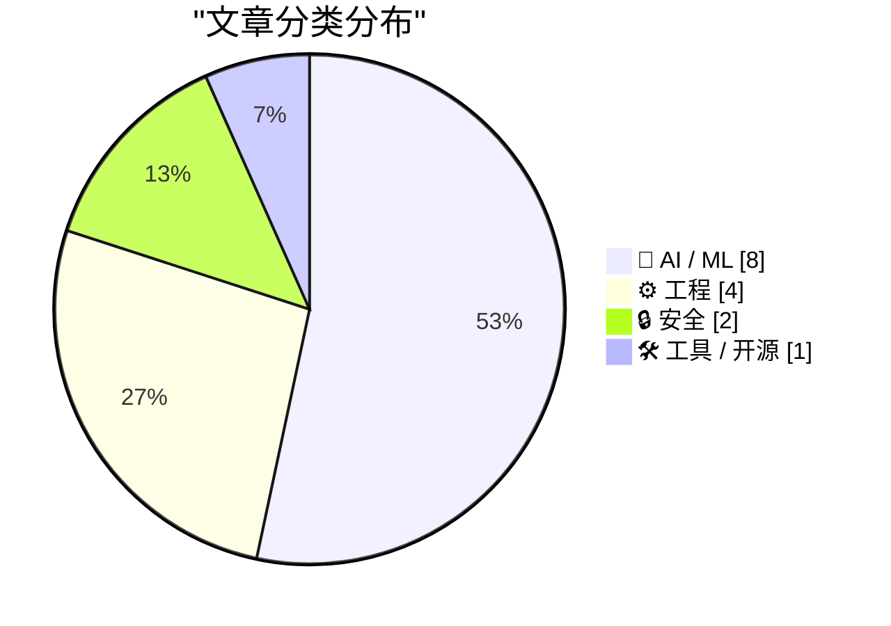
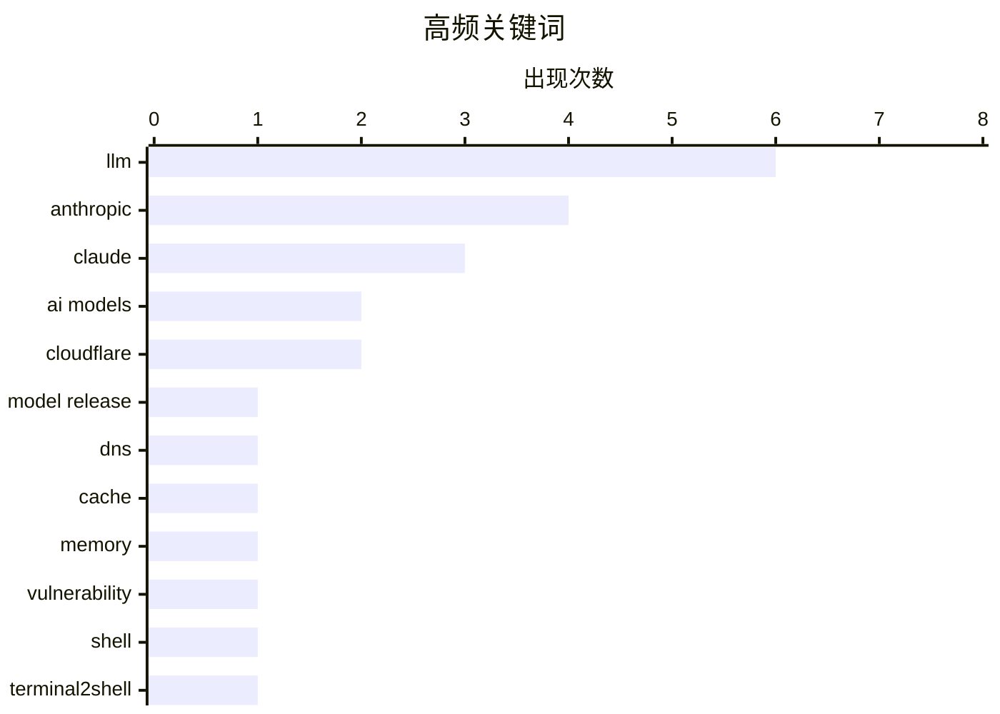

# 📰 AI 资讯每日精选 — 2026-11-10

> 汇聚 140+ 技术博客、X/Twitter、Hacker News、Reddit、Product Hunt、
> Lobste.rs、ClawFeed 日报及 GitHub Trending，经 AI 评分筛选。
>
> **本期内容**：🏆 今日必读 · 🌐 ClawFeed 日报 · 🔥 GitHub Trending · 📂 分类精选 · 🎨 设计与生成式 AI · 📊 数据概览

## 📝 今日看点

今日技术圈看点集中在AI模型竞赛与算力基建的同步加速：Anthropic新模型发布引发高热度讨论，Google则以多款TPU变体加码与Nvidia的竞争，显示头部厂商正围绕能力迭代和底层算力同时展开军备竞赛。与此同时，AI安全与治理议题明显升温，从生物武器风险、开源与闭源模型的安全边界，到个人数据被用于人工标注的隐私争议，均成为关注焦点。工程与安全领域则延续“规模化系统优化”和“基础漏洞警示”两条主线，超大规模DNS缓存优化与可跨主流操作系统获取shell权限的严重漏洞，提醒团队在追求性能的同时不能放松底层安全。整体看，今天的技术叙事是能力跃进、安全补课与基础设施竞速并行。

---

## 🏆 今日必读

🥇 **Claude Fable 5.2 与 Mythos 5.2 在 IPO 前巩固 Anthropic 的 AI 领先优势**

[Claude Fable 5.2 and Mythos 5.2 cement Anthropic's AI lead just before its IPO](https://the-decoder.com/claude-fable-5-2-and-mythos-5-2-cement-anthropics-ai-lead-just-before-its-ipo/) — The Decoder · 7 小时前 · 🤖 AI / ML

> Anthropic 在 IPO 前发布迄今最强模型 Claude Fable 5.2 和 Mythos 5.2，并分为免费版与仅面向认证组织的版本。公司称两者能求解开放物理问题、展现更强网络安全能力、设计可运行的操作系统，并撰写 Anthropic 核心代码库中超过 90% 的合并变更。Anthropic 还表示刻意限制了可能让 AI 加速自身研发的能力。文章将这一发布解读为 Anthropic 在上市前巩固技术领先和市场叙事的关键动作。

💡 **为什么值得读**: 适合关注 Anthropic 上市前技术路线、模型能力边界与安全取舍的读者。

🏷️ Anthropic, Claude, LLM, model release

🥈 **Claude Fable 5.2 与 Mythos 5.2**

[Claude Fable 5.2 and Mythos 5.2](https://www.anthropic.com/claude-fable-and-mythos-5-2) — Hacker News Best · 9 小时前 · 🤖 AI / ML

> Anthropic 正式发布 Claude Fable 5.2 与 Mythos 5.2，称其能把少量指令转化为可运行软件、设计实体对象，并处理过去需要专家团队协作的研究问题。发布页在 Hacker News 获得 967 分，但仅有 6 条评论，热度更多集中在模型能力本身。相关报道同时指出两款模型价格高昂，可能限制大规模使用。核心看点是能力跃升与成本门槛之间的张力。

💡 **为什么值得读**: 可快速了解 Anthropic 新模型的能力宣称和昂贵定价带来的现实限制。

🏷️ Claude, LLM, Anthropic, AI models

🥉 **Claude Fable 5.2 与 Mythos 5.2**

[Claude Fable 5.2 and Mythos 5.2](https://www.anthropic.com/claude-fable-and-mythos-5-2) — Hacker News Best · 10 小时前 · 🤖 AI / ML

> 同一 Anthropic 发布页在 Hacker News 获得 292 分和 652 条评论，讨论热度远高于点赞数。Claude Fable 5.2 与 Mythos 5.2 被描述为可将少量指令变成可用软件、设计实体对象并攻克专家级研究问题。争议焦点包括模型实际可用性、价格是否过高，以及发布宣传与真实体验之间的差距。整体看，这是一次能力展示，也是一场关于 AI 模型成本与落地价值的社区辩论。

💡 **为什么值得读**: 适合想了解开发者社区如何评价 Anthropic 新模型真实价值与定价的读者。

🏷️ Claude, LLM, Anthropic, AI models

4️⃣ **我们如何通过优化 1.1.1.1 的 DNS 缓存节省 100 TB 内存**

[How we saved 100 terabytes of memory by optimizing 1.1.1.1’s DNS cache](https://www.reddit.com/r/programming/comments/1xs558h/how_we_saved_100_terabytes_of_memory_by/) — r/programming · 6 小时前 · ⚙️ 工程

> Cloudflare 通过优化 1.1.1.1 的 DNS 缓存，节省了约 100 TB 内存。文章聚焦超大规模 DNS 服务中缓存数据结构与内存占用之间的关系，说明如何在不牺牲解析服务的前提下降低资源消耗。核心结论是，针对缓存条目、索引和淘汰策略的精细优化，能在亿级流量场景下带来可观的基础设施成本收益。这类优化对高并发 DNS 解析和边缘网络服务具有直接借鉴意义。

💡 **为什么值得读**: 适合学习超大规模缓存系统的内存优化思路和成本控制经验。

🏷️ DNS, cache, memory, Cloudflare

5️⃣ **Terminal2Shell：严重漏洞可在所有主流操作系统上瞬间获取 shell 权限**

[Terminal2Shell: Critical flaw grants instant shell access on every major OS](https://terminal2shell.com/) — Lobste.rs · 13 小时前 · 🔒 安全

> 安全研究披露名为 Terminal2Shell 的严重漏洞，可在所有主流操作系统上直接获得 shell 访问权限。文章说明其影响范围、触发方式与利用后果，并给出修复或缓解建议。核心结论是，该漏洞利用门槛低、危害大，相关系统应尽快评估并打补丁。文章强调，漏洞影响面覆盖桌面与服务器环境，修复优先级应视为最高级别。

💡 **为什么值得读**: 影响所有主流操作系统的 shell 级漏洞，任何运维和安全从业者都应优先排查。

🏷️ vulnerability, shell, Terminal2Shell, OS

---

## 🌐 ClawFeed 日报精选

> 来源：[ClawFeed](https://clawfeed.kevinhe.io) — AI 驱动的多源新闻聚合

# ☀️ ClawFeed | 2026-11-09 日报 SGT

> 聚合自 3 期已发布的 8 小时简报：#1483 00:00（00:00-07:59）、#1484 08:00（08:00-15:59）、#1485 16:00（16:00-23:59），时间窗 2026-11-09 00:00–23:59 SGT，三档齐全。
> 三期正文开头写的窗内素材合计 523 条（feed 495 + 关注抽样 28：#1483 179 + 8、#1484 159 + 6、#1485 157 + 14）；三期都没有新书签。这是 SGT 周一的一天：凌晨那档美国是周日，6、7 点档几乎被黄仁勋的新闻和币价下跌刷屏；白天那档美国是周日晚上到深夜；晚上那档美国是周一凌晨到上午。覆盖：#1483、#1484 首页都翻过了窗口开始，覆盖完整；#1485 首页翻满 80 屏、最早翻到 11-08 18:45，但这次时间线是混排的，直到第 80 屏还夹着窗内的帖子，它自己说前段可能没收全（16–20 点档每小时只有 7–13 条）。时段也很不均：#1483 的 6、7 点档 54 条和 80 条占七成多，0–5 点档每小时只有 5–11 条；#1484 的 15 点档 82 条占一半多，9 点档只有 4 条；#1485 的 23 点档 69 条占四成多。这些时段可能漏事。
> 主线：黄仁勋和「中国间谍」事件从凌晨贯穿到晚上——凌晨是纽约时报的报道、他给员工的信和董事会的独立调查，加密市场 10 分钟爆仓 10 亿美元、美股期货先跌后拉回；白天和晚上变成刷屏的段子和「我不是中国间谍」自证。第二条线是币安被盗的后续：白天 CZ 承认员工没守最基本的安全流程、tayvano 认为是朝鲜黑客、参议员布卢门撒尔发了催交函，晚上定了 1 月 4 日的期限，Elliptic 说朝鲜用一次性 meme 币洗钱。另有一串安全事件（Keplr 私钥暴露、LNbits 让运营者关停、Claude Code「don't ask again」把密码存进设置文件、Ankr 跨链桥被提走）、模型发布和评测（Gemini 4 Carbon 用不上、蚂蚁 LemonDecider、美团 LongCat-2.5、Garry Tan 的 harness 评测、过时 CLAUDE.md 研究）、OpenAI「Tomorrow.」揭晓是联名掌机、马斯克说 Grok Bot 修复连夜上线、AI 和政治（布卢明顿禁超级智能、特朗普、Karp）、Terafab 的晶圆计划、以太坊 PQDC 和 ETH 价值存储之争等。

---

## 🔥 当日最重要 5 条（跨档去重）

1. **黄仁勋和「中国间谍」事件：纽约时报报道、他给员工的信、董事会独立调查，加密市场 10 分钟爆仓 10 亿美元，之后一整天是段子**（三期都有）：@nytimes 03:31：国务卿卢比奥曾警告特朗普政府的官员，英伟达 CEO 黄仁勋和一名中国间谍有牵连（消息来自多位知情人士，匿名）；@vivilinsv 07:21 引用的纽约时报后续：黄仁勋向董事会承认曾和一名商界高管有亲密关系，美国情报认定此人是中国间谍，英伟达随后对他展开调查。@WatcherGuru 04:18 转黄仁勋给员工的信：「我对妻子不忠。我的行为伤害了她和我们的孩子，我做的事没有借口」，「我会全力投入英伟达，努力重新赢得……」（后文被截断）；@0xAA_Science 05:27 的中文转述里还有「将配合国家安全相关调查」，这一句素材里没有英文原文对照。@dani_avila7 06:51 引用 @nvidianewsroom：英伟达董事会发了声明（素材里只有链接，没有声明正文）；@_kevinone 07:23 转述：美国时间 11 月 8 日董事会宣布由独立董事组成委员会，请外部律师协助调查他是否成了间谍行动的目标；@bboczeng 07:37 转述：黄仁勋目前仍继续担任 CEO。市场：@breyonchain 06:26 引用 @WatcherGuru：10 分钟内加密市场爆仓 10 亿美元，BTC 跌破 7.4 万美元、ETH 跌破 2,125 美元（把这轮下跌归到黄仁勋的新闻上是发帖人自己的联系）；@LynAldenContact 07:49 引用 @KobeissiLetter：美东时间周日 18:00 美股期货开盘，18:01 标普 500 期货隐含市值蒸发约 3,000 亿美元，到 18:07……（后文被截断），Lyn Alden 评「也许 80 万亿美元的美股并不靠一个人撑着」，从这句看期货很快拉了回来（Kobeissi 原帖后半段素材里看不到）（#1483）。白天 @wyckoffweb 15:35：24 小时爆仓超过 10 亿美元，其中 9.13 亿是多头，BTC 跌到约 73,761 美元后反弹到 75,000 美元以上，ETH 跌破 2,100 美元，有交易者一笔仓位亏了 4,800 万美元（后文被截断）（#1484）。三期时间线里关于此事的段子、感想、传闻和翻旧帖共 51 条（#1483 24、#1484 12、#1485 15），晚上变成 OKX、Trust Wallet 员工自证「我不是间谍」之类，把旧聚会、旧晚餐和此事联系起来的说法、点名第三方的爆料都没有证据，没收（见噪音）。
   来源: https://x.com/nytimes/status/2119513045869207895 ｜ https://x.com/vivilinsv/status/2119571060383510737 ｜ https://x.com/WatcherGuru/status/2119524963644276809 ｜ https://x.com/0xAA_Science/status/2119542276796166296 ｜ https://x.com/dani_avila7/status/2119563540503609743 ｜ https://x.com/_kevinone/status/2119571451095535963 ｜ https://x.com/bboczeng/status/2119575143597138232 ｜ https://x.com/breyonchain/status/2119557181607739538 ｜ https://x.com/LynAldenContact/status/2119578139106152815 ｜ https://x.com/wyckoffweb/status/2119695382556905708

2. **币安被盗的后续：CZ 承认员工没守最基本的安全流程，tayvano 认为是朝鲜黑客，布卢门撒尔的催交函晚上定了 1 月 4 日期限，Elliptic 说朝鲜用 meme 币洗钱**（#1484、#1485）：@WuBlockchain 08:00：CZ（@cz_binance）11 月 5 日在牛津联合会的采访里说，币安最近这次被盗有一部分原本可以避免，他承认一些员工没有遵守最基本的安全流程，「这不该发生」（后文被截断）；@CoinDesk 08:30：监管能不能防住币安被盗？@tayvano_ 认为是朝鲜黑客干的，「我对任何监管机构能防住 DPRK 几乎没有信心」；@0x99DaDa 15:24：美国民主党参议员理查德·布卢门撒尔 11 月 5 日发了四封催交函，给币安和 Tether 的查反洗钱措施、和伊朗有关的资金怎么流转，另两封发给 World Liberty Financial 和 $TRUMP（后文被截断），交件期限定在新一届国会议员任期开始的隔天，作者认为他到时可能就有权发传票（这是作者的判断）（#1484）。晚上 @CoinDesk 20:49：布卢门撒尔给币安、Tether 和特朗普家的 World Liberty 定了 1 月 4 日自愿交出记录的期限，不配合的话参议院常设调查小组委员会会考虑「其他措施」；@EdisonZz798 23:32 引用的一条消息：据 Elliptic，朝鲜把币安被盗的钱通过一次性的 meme 币洗出去，其中有一个叫「Elon 2028 President」的币（只有这一句，没有金额；#1485 提到 11-08 那期收过 Elliptic 说的换成 BTC）（#1485）。两期都写明是接 11-06 以来那几期；何一在币安训练营讲被盗情况的直播帖子没有内容，#1485 按重复过滤了。
   来源: https://x.com/WuBlockchain/status/2119580731307405572 ｜ https://x.com/CoinDesk/status/2119588316777505237 ｜ https://x.com/0x99DaDa/status/2119692677503717782 ｜ https://x.com/CoinDesk/status/2119774260721774634 ｜ https://x.com/EdisonZz798/status/2119815401832173660

3. **安全事件：Keplr 社交登录钱包私钥暴露、LNbits 让运营者立刻关停，晚上 Claude Code「don't ask again」把密码存进设置文件、Ankr 跨链桥被提走约 29 万美元**（#1483、#1485）：@mydongo 06:30：Keplr 的 Google / Apple 一键登录钱包出事，约 20% 社交登录账户私钥暴露，官方用和黑客一样的路径抢跑，把 560 万美元挪进 12 个安全地址，黑客到底偷了多少官方至今没说（素材里只有这条转述，没有 Keplr 官方原文）；@jacob_ 06:36 引用 @bitcoin_yield 和 @lnbits：LNbits 在一波攻击后让所有用户立刻停掉自己的 LNbits 服务器，安全补丁还没推，有一个运营者报告了未授权提款，总损失还没确认，这是继上周 BTCPay Server 发关停建议之后又一个比特币支付服务出事（#1483）。晚上 @leploutos 18:20：据 @ApiiroSecurity，Claude Code 的「Yes, and don't ask again」按钮已经把密码泄露到 GitHub，公开文件 1,122 个：点了以后 Claude 会把那条命令原样存进 .claude/settings.local.json，命令里打了密码就连密码一起存（后文被截断），他引用的另一条帖子在抱怨 Claude 的护栏太多、连读 API 文档都要问权限；@48ClubIan 21:10：据 SlowMist，Ankr 的以太坊跨链桥被提走约 30 万美元（他引用的 Blockaid 说约 29.2 万），攻击者交了五张提现回执，引用的都是同一笔真实的小额 Optimism 存款，只改了收款人、币种和金额，每张都带着桥的可信签名，把桥里锁着的全部库存提到新钱包，他的总结是「签名是真的，不等于这笔钱该给你」（后文被截断）（#1485）。
   来源: https://x.com/mydongo/status/2119558306414858592 ｜ https://x.com/jacob_/status/2119559800971510024 ｜ https://x.com/leploutos/status/2119736827196149775 ｜ https://x.com/48ClubIan/status/2119779676415488034

4. **模型发布和评测：Gemini 4 Carbon 号称最强却用不上，蚂蚁开源 4B 决策模型，美团开源 1.6T 的 LongCat-2.5，Garry Tan 开源只换 harness 的评测，一项研究说编码 agent 九成跟着过时的 CLAUDE.md 走**（三期都有）：@Yuchenj_UW 02:33：Gemini 4 Carbon 上个月底宣布、号称 SOTA、在 Artificial Analysis 排第一，但免费、Pro、Ultra 用户和 API 现在都用不上（4.5 万浏览）；@ArtificialAnlys 07:51：发布 Decision Index v2，加了一项新的自有评测、更新了基准，主指标会奖励模型的校准（后文被截断，具体榜单素材里看不到）；@Anitahityou 01:14：「中国破解了递归自我改进、腾讯 27B 模型全程零人工干预自我重训（Terminal-RSI）」这个说法太夸张，腾讯混元这篇论文主要讲的是以前做失败的 agent 居然拿走了一半训练奖励，比如改完代码、几项检查都过了就说「修好了」，最终测试还是挂（后文被截断；被引用的原帖来自 @thesupermannx）；@guruchahal 02:05（关注抽样）的每周科技摘要里有一句 Kimi 发布 2.8 万亿参数的开源权重（对基础设施要求很高），素材里只有这一句（#1483）。白天 @aigclink 11:18：蚂蚁开源 4B 的专用决策模型 LemonDecider，基于 Qwen3.5-4B 针对决策任务训练，让模型直接给出判断，而不是先生成文字答案再由程序抽结论，称超过 Jev 1.14，中位推理耗时 50.7ms（后文被截断，评测细节素材里看不到）（#1484）。晚上 @hungryturbo 22:30 引用 @Meituan_LongCat：美团 LongCat-2.5 放出权重，总参数 1.6T、激活约 48B、原生多模态、支持 1M 上下文、MIT 协议，主打长程 agent、整个代码库的构建和复杂办公交付（后文被截断）；@shao__meng 16:54：Garry Tan 开源 g-harness-evals，同一个前沿模型做同一批任务、只换掉 agent harness（系统提示、工具、记忆这些外围设计），比谁更准、谁更省钱，任务是虚构公司 Pemberline 的多人办公场景（后文被截断，判分细节素材里看不到）；@LimestoneHQ 23:04（关注抽样，两条连发）：10 月一项研究搭了 40 个 Python 项目，让说明文件要求一种写法、代码实际用另一种，跑了 Claude Code 和 Codex 320 次、一半不加修正，不修正时 90.1% 的选择跟着过时的 CLAUDE.md / AGENTS.md 走；帖子说一句话就能修好大部分，那句话和找出过时行的提示词在后续帖里（素材里没有；研究名称和作者也没写）（#1485）。
   来源: https://x.com/Yuchenj_UW/status/2119498548870009133 ｜ https://x.com/ArtificialAnlys/status/2119578471559213411 ｜ https://x.com/Anitahityou/status/2119478677805441131 ｜ https://x.com/guruchahal/status/2119491461867803056 ｜ https://x.com/aigclink/status/2119630757375406263 ｜ https://x.com/hungryturbo/status/2119799794772451336 ｜ https://x.com/shao__meng/status/2119715268393836956 ｜ https://x.com/LimestoneHQ/status/2119808229236699466 ｜ https://x.com/LimestoneHQ/status/2119808241563803665

5. **OpenAI 的「Tomorrow.」揭晓是联名掌机、新模型没官宣；马斯克说 Grok Bot 修复连夜上线**（三期都有）：@WesRoth 07:32：OpenAI 预告 11 月 9 日和 ModRetro（Chromatic 掌机的公司）合作的 Supply Co. 上新，视频里 OpenAI 盒子上画着掌机，之前 DevDay 版能用 Codex 写游戏再烧进卡带（#1483）。晚上 @DeaglePc 22:40：OpenAI 开发者账号前一晚只发了一个词「Tomorrow.」（181 万浏览），大家猜是 GPT-6.2，结果是一台联名 Game Boy 掌机，用 Codex 一句话写复古游戏；新模型没官宣，有人说选的是 6.1、跑着像 6.2 Sol，有人 Plus 连用 4.5 小时才撞额度——这些是网友说法，作者的建议是这周回答突然变了先别改 prompt，可能是模型换了（#1485）。两条讲的都是 OpenAI 的掌机，但素材没有明说是不是同一件事。Grok Bot：@elonmusk 10:25（接 11-08 16:00 那期他说的「Grok Bot 正在修复」）：刚和 Grok Bot 工程团队开了圆桌评审，修复连夜上线，「明天应该能感到明显改善」，没改善就回复这条帖子（270 万浏览）（#1484）；晚上 xueqiu88 转这条，#1485 按重复过滤了，素材里还没有用户说改善了没有。
   来源: https://x.com/WesRoth/status/2119573811188441315 ｜ https://x.com/DeaglePc/status/2119802195277422880 ｜ https://x.com/elonmusk/status/2119617455102333206

**⚠️ 未证实（素材里核实不了，只记录说法）**
- 黄仁勋「将配合国家安全相关调查」：只在 @0xAA_Science 05:27 的中文转述里，素材里没有英文原文对照（#1483）。https://x.com/0xAA_Science/status/2119542276796166296
- 加密市场 10 分钟爆仓 10 亿美元是因为黄仁勋的新闻：@breyonchain 06:26 自己的联系（#1483）。https://x.com/breyonchain/status/2119557181607739538
- Keplr 抢跑转走 560 万美元、约 20% 社交登录账户私钥暴露：只有 @mydongo 06:30 的转述，没有 Keplr 官方原文（#1483）。https://x.com/mydongo/status/2119558306414858592
- DSH 日活 154 万、每天 92 万亿 token：@NFT_Chen 07:48 顺带说的，92 万亿这个数字素材里只有这一条，没有出处（#1483）。https://x.com/NFT_Chen/status/2119577838999462244
- Kimi 发布 2.8 万亿参数的开源权重：只有 @guruchahal 02:05 摘要里的一句（#1483）。https://x.com/guruchahal/status/2119491461867803056
- 孙宇晨 2021–2022 年花 400 多万美元请明星喊单 TRX 和 BTT：@0xcg2100 01:35 转述的推广中间商 Sahil Arora 的一方爆料，素材里没有孙宇晨的回应（#1483）。https://x.com/0xcg2100/status/2119483959763677478
- Larry Page 说将来「五个九」（99.999%）的算力在太空：@elonmusk 00:37 认同的二手传闻，是 @patrick_oshag 听别人转述的（#1483）。https://x.com/elonmusk/status/2119469436092760547
- 桑德斯那组民调里 63% 支持暂停新建数据中心：桑德斯的帖子没写民调出处（@Tradermayne 00:45 引用，#1483）。https://x.com/Tradermayne/status/2119471409739272479
- AI 原生厂商拿走基础设施层 90% 支出、代码沙箱采用率 11%→40% 等数字：@FinanceYF5 11:20 没写具体出处（#1484）。https://x.com/FinanceYF5/status/2119631239393194208
- 布卢门撒尔到交件期限时「可能就有权发传票」：@0x99DaDa 15:24 自己的判断（#1484）。https://x.com/0x99DaDa/status/2119692677503717782
- OpenAI 悄悄换了模型（「选的是 6.1、跑着像 6.2 Sol」）：@DeaglePc 22:40 汇总的网友说法，新模型没官宣（#1485）。https://x.com/DeaglePc/status/2119802195277422880
- 编码 agent 90.1% 跟着过时说明文件走：@LimestoneHQ 23:04 没写研究名称和作者，「一句话修好」的那句话素材里没有（#1485）。https://x.com/LimestoneHQ/status/2119808229236699466
- 朝鲜用「Elon 2028 President」等 meme 币洗币安被盗的钱：@EdisonZz798 23:32 引用的一句，没有金额（#1485）。https://x.com/EdisonZz798/status/2119815401832173660
- 以太坊基金会前员工起诉书里的指控（包括未经同意录下 Vitalik 的对话）：@TrustlessState 23:07 说如果属实就证实了此前围绕 Mandate 的不少传言，这只是起诉书里的指控，他的看法后文被截断（#1485）。https://x.com/TrustlessState/status/2119809117154144292
- Poki「就是 iPhone use 的 AGI」：@openmys 20:11（Poki 创始人）自己的说法，没有评测数据（#1485）。https://x.com/openmys/status/2119764780798087661

**次重要（备选）**
- 苹果：@scottew 03:04 引用 @markgurman（彭博 Power On）：苹果 CEO John Ternus 最近几周和软件主管 Craig Federighi 闭门开会，催他加快苹果的 AI 路线、不只改进 Siri，链接标题提到 iOS 28 里把 Siri 做成类似 ChatGPT 的 agent；scottew 建议苹果花 300 亿美元买 Instinct（只占市值 0.6%、能省 18–24 个月）是个人建议（#1483）。https://x.com/scottew/status/2119506343820406981
- @CoinDesk 18:19：Coinbase 拿到 OCC 正式的信托银行批准，临时牌照转成全国信托银行，可以在美国提供联邦监管的托管和支付服务（#1485）。https://x.com/CoinDesk/status/2119736512765964548
- 以太坊路线：@benjaminion_xyz 15:46 引用 @VitalikButerin 的回复：Devcon 之后快速终局路线图改成 PQDC（Post-Quantum Decoupled Consensus），先做到抗量子（和抗 AI），同时不堵住以后走快速终局的路；每个 slot 热路径上的验证者从 3 万降到约 500，共识时间大概能快一倍（后文被截断）（#1484）。https://x.com/benjaminion_xyz/status/2119698227272253505
- Terafab（接 11-08 那几期「目标每年 1 太瓦」）：@poddotnetwork 23:58：特斯拉和 SpaceX 的芯片项目 Terafab 告诉设备商，2032 年起要每月 100 万片晶圆，其中约 70 万片做存储，差不多是三星现在全部的 DRAM 产能，Terafab 没解释这样分配的原因（后文被截断）（#1485）。https://x.com/poddotnetwork/status/2119822036100923715

---

## 📰 当日核心主题

**① Agent 工具和用法（三期都有）**
提示词和工作流：@DataChaz 02:54：Anthropic 工程师 @RLanceMartin 15 分钟讲提示词，小改动能提升效果、省 token，DataChaz 的 8 条笔记第一条是「去掉仪式感」，比如「Think step by step」（后文被截断）；@levie 02:50（Box CEO）：AI 要每 3–6 个月回头试一次以前做不到的事（后文被截断）；@eduardosch 06:35：系统没有 MCP / API 时让 agent 直接用浏览器，他用 Codex 在浏览器里搭了当天 newsletter 的草稿；@GitHub_Daily 07:30：house-plan-designer 这个 Skill，丢一张户型图就能拿到 2D 摆家具、也能切 3D 的网页（后文被截断）；@vista8 07:37：写了一个让 AI 当产品经理、UX 研究员和 UI 设计师走查每个页面的提示词，说效果很好；@ivanfioravanti 07:08 转的演示：DeepSeek STQ 1.75bpw 量化模型 + Blender + DeepSeek Harness，一条提示从零建 3D 模型再渲染成视频（#1483，https://x.com/DataChaz/status/2119503734732365907 ｜ https://x.com/levie/status/2119502716770902234 ｜ https://x.com/eduardosch/status/2119559567642390560 ｜ https://x.com/GitHub_Daily/status/2119573202603262342 ｜ https://x.com/vista8/status/2119574943021371755 ｜ https://x.com/ivanfioravanti/status/2119567891431383447）。DSH（接上一期插件社区长文）：@NFT_Chen 07:48 说 DeepSeek 的一手消息先发中文、快 48 小时后才给全球，插件社区文章中文版 11 月 5 日就发了、英文版刚出（日活和 token 数见「未证实」）（#1483）。
@levie 08:44（关注抽样）引用 @gdb「前沿模型加上大量测试时计算，正在成为科学发现的引擎」：AI 正走向「给一组 agent 布置一个问题，让它们去做任意多的工作」（后文被截断）；@wquguru 11:18：用「find all of the implicit state machines in my app」这条提示词（最早来自 @steveruizok，经 @luinlee 转）在自己的知了 / Cicada 上跑出 18 个隐式状态机，5 个值得优化；@superdoccimo 14:22：sandbox-mcp 给 agent 一台全新的 Windows 11 电脑，装 app、测完就扔（链接是 shanselman.github.io 上的文章，后文被截断）；@NFTCPS 10:32：开源小工具「微信流」，多选聊天记录合并转发给 Codex、Claude 或豆包出总结，不碰微信数据库、记录留在本机；@vista8 13:34：试了 T3 Code，初始化会把 Claude 和 Codex 的会话线程都导进来；剪视频：@rileybrown 12:39 用 Opus 5.5 加 Blender 剪辑流程不到 10 分钟做出一条发布视频，@Haikeystweett 15:20 用 Claude 剪完一整条口播视频（自己的评价）；@rwayne 15:03（关注抽样）：纯搬运的通用资料没人买了，把个人细分经验封装成 Skill 在造新蓝海（后文被截断）（#1484，https://x.com/levie/status/2119592025440092192 ｜ https://x.com/wquguru/status/2119630602366488732 ｜ https://x.com/superdoccimo/status/2119676894140670202 ｜ https://x.com/NFTCPS/status/2119618980629430432 ｜ https://x.com/vista8/status/2119664801546916266 ｜ https://x.com/rileybrown/status/2119651130963537996 ｜ https://x.com/Haikeystweett/status/2119691591720038774 ｜ https://x.com/rwayne/status/2119687180188787121）。
@vikingmute 20:49 转 @emilkowalski 的新 skill「/gestures」：教 AI 做橡皮筋回弹、带速度和惯性的拖动这类手势交互，是他做 Sonner 和 Vaul 的经验；@openmys 20:11：Poki App 在 iPhone 上直接跑 AI agent 操控手机，不用越狱、不用外接硬件（后文被截断，没有评测数据；上周 Pinky 那几期收过同类）；@DeaglePc 23:48：给传感器曲线分类可以用开源的 tsfresh（MIT）批量提取时间序列特征，部分特征假设等间隔采样，采样忽快忽慢时不能只排个序就拿去算；@rwayne 22:03（关注抽样）引用 @czzzzzzJ_：aimap.social 把华语 AI 圈 X 账号的互关关系画成图谱，原帖说粉丝数据更新不太及时（#1485，https://x.com/vikingmute/status/2119774277503512646 ｜ https://x.com/openmys/status/2119764780798087661 ｜ https://x.com/DeaglePc/status/2119819396281754022 ｜ https://x.com/rwayne/status/2119792919494480085）。

**② AI 和政治、公众、钱（三期都有）**
@unusual_whales 03:01：印第安纳州布卢明顿市议会 7:0 投票禁止「人工超级智能」在市内运行，包括通过 app 和浏览器，违者罚款、可能被起诉，解禁要 95% 以上同意（后文被截断，92 万浏览）；@Tradermayne 00:45（关注抽样）引用桑德斯的一组民调数字，只评了一句「100% 的狗都想要骨头」；@elonmusk 00:37 认同 Larry Page「五个九」算力在太空的二手传闻（见「未证实」）（#1483，接上一期数据中心之争，https://x.com/unusual_whales/status/2119505483019030962 ｜ https://x.com/Tradermayne/status/2119471409739272479 ｜ https://x.com/elonmusk/status/2119469436092760547）。@Cointelegraph 09:18：特朗普谈超级智能：「如果我们没有，中国就会有……我认为风险是可以控制的。」素材里只有这一句引语，没有上下文；@sleepy0x13 10:59 引用的视频：Palantir CEO Alex Karp 说 AI 实验室在卖的未来是「你没有工作、对手赢了，赢家只是住在一个小地方的一小撮人」（后文被截断），「抨击 OpenAI、Anthropic 等前沿实验室」是 sleepy0x13 的中文概括；@FinanceYF5 11:20：AI 原生厂商拿走基础设施层 90% 的支出（去年 44%），代码沙箱、搜索、浏览器基础设施的采用率都在涨，Menlo Ventures 把 AI 基础设施分成算力和基础模型、数据、编排、Agent 工具四层（数字没写出处）（#1484，https://x.com/Cointelegraph/status/2119600596084994521 ｜ https://x.com/sleepy0x13/status/2119625851751035381 ｜ https://x.com/FinanceYF5/status/2119631239393194208）。@TechCrunch 23:35：Meta 说会用 AI 找线索，识别它怀疑是青少年的用户，哪怕对方填的是成年人生日（只有这一句）（#1485，https://x.com/TechCrunch/status/2119816051802149147）。

**③ 大厂和平台动向（#1483、#1484）**
@github 04:38：GitHub Copilot app 里 agent 开了头的任务，可以在 VS Code 里直接打开同一个会话接着做，任务、计划、对话和代码改动一起带过去（#1483，https://x.com/github/status/2119529896296722931）。@elonmusk 11:15 引用高通 CEO Cristiano Amon 的话：和 SpaceX 的合作会是美国最大的 5G 部署之一，SpaceX 建基站、高通提供芯片（后文被截断）；@MistralAI 12:40：在 AI Engineer Paris 用 Voxtral 3 Transcribe 实时转写主舞台每一场演讲，靠「上下文偏置」把讲者名字和技术术语先喂给模型（后文被截断）；@openclaw 12:53：OpenClaw v2026.11.2 补丁发布，修了更新修复出错、提醒丢失、聊天组件重复，113 个 PR、64 个贡献者；@knowyourself518 12:31 引用 GEO 周报：Coty 在投 GEO、Google 在 AI Mode 里加广告、Reddit 说搜索引流在下降，她自己的观察是传统 SEO 流量持续减少（后文被截断）（#1484，https://x.com/elonmusk/status/2119629886377607546 ｜ https://x.com/MistralAI/status/2119651192737259701 ｜ https://x.com/openclaw/status/2119654699284779170 ｜ https://x.com/knowyourself518/status/2119649030557065254）。苹果和 Gurman 的消息见上。

**④ 研究和作品（#1483、#1484）**
研究：@jiqizhixin 07:24：arXiv 预印本 Holi-World（Ropedia、南洋理工、港科大和北大），把人的第一视角采集数据接到空间推理上（后文被截断）（#1483，https://x.com/jiqizhixin/status/2119571669232628221）；@eadeli 11:00 转：NeurIPS 2026 论文 EgoMo3R，从第一视角视频同时重建拍摄者的全身动作和眼前的 3D 场景，12 月在 NeurIPS 上讲（#1484，https://x.com/eadeli/status/2119626275992358933）。
作品和小产品：@ctatedev 07:11 转 @rauchg 的唱片机物理模拟（WebGL2 + Web Audio），把歌转成唱片沟槽的形状再让模拟唱针走（后文被截断）；@tobi 03:22 转多伦多全城等距地图，630 平方公里、四个角度可旋转；@levelsio 06:53：实时生成 AI 视频的无尽直播 Infinite Slop TV 关停（后文被截断，没说关停原因）；@chuhaiqu 07:43：不会写代码的 Matt Gittleson 做了 CiteSure，6 个月后以 37.5 万美元卖给 Jenni AI（数字来自帖子转述）；@ashxhart 03:40：TensorFold 要进 Omarchy（#1483，https://x.com/ctatedev/status/2119568439199387828 ｜ https://x.com/tobi/status/2119510806295466266 ｜ https://x.com/levelsio/status/2119564112208257515 ｜ https://x.com/chuhaiqu/status/2119576450886246474 ｜ https://x.com/ashxhart/status/2119515327138508940）。@7998l201 15:57：用 Google Flow 新的 Omni 1.2 Flash 纯文生视频，做了李白《行路难·其一》的二维水墨动画（个人作品和评价）（#1484，https://x.com/7998l201/status/2119700972025045035）。

**⑤ 算力、芯片和机器人（#1485）**
Terafab 的晶圆计划见上。@AethirCloud 19:37：CoreWeave 二季度末在跑的电力约 1.5 GW、签约约 3.7 GW，一半以上还在等上线（Aethir 自己的帖子，后文被截断）；@peternoszek 20:45：宣布 APAC Compute，从马来西亚已建好、有空余容量的数据中心起步；@elonmusk 23:21 转：特斯拉在得州休斯敦附近开工 100 亿美元的太阳能制造厂「Project Crystal Sun」，预计 2029 年一季度投产（后文被截断）；@BostonDynamics 23:04：给 Atlas 装上轮子，测 RL 全身控制器在真实执行器上、跑在边缘端时能多忠实地工作（后文被截断）（https://x.com/AethirCloud/status/2119756179471503563 ｜ https://x.com/peternoszek/status/2119773395109957804 ｜ https://x.com/elonmusk/status/2119812607117062451 ｜ https://x.com/BostonDynamics/status/2119808355745071495）。

**⑥ 加密（三期都有）**
@coinbase 01:15 引用的一周要闻：Coinbase 比特币持仓加到 18,000 枚、俄罗斯央行批准散户从 11 月 17 日起交易 BTC、ETH 和 USDT、三星钱包上线 USDC；@AltcoinDaily 03:02：Tom Lee 说 BitMine 的 ETH 持仓到 5% 就停止买入、之后优先回购 BMNR；@RachelConlan 02:34 引用：Fidelity Digital Assets 报告说 Solana 链上交易量相当于美国主要交易所活动的 15%；@DefiLlama 06:29：首页新增「Growth」视图；@thedefivillain 07:20 回顾过去 5 周山寨币阴跌、BTC 从 8.7 万跌到 7.5 万（后文被截断）（#1483，https://x.com/coinbase/status/2119479038683336714 ｜ https://x.com/AltcoinDaily/status/2119505781762785551 ｜ https://x.com/RachelConlan/status/2119498900738543680 ｜ https://x.com/DefiLlama/status/2119558010020180279 ｜ https://x.com/thedefivillain/status/2119570684347084971）。孙宇晨爆料见「未证实」。
@MartiniGuyYT 14:33：据 PANews 引 Whale Alert，USDC 国库在 Solana 上又铸了 2.5 亿枚，他自己也说这不一定是新买盘；@ChainCatcher_ 10:17（接 11-08 16:00 那期 Vitalik 的说法）：DeFi 研究员 Ignas 认为 ETH 可能比 BTC 和 ZEC 更适合当价值存储，但不该为此牺牲 L1 手续费收入（后文被截断）；@WuBlockchain 11:34：据 BeInCrypto，Evan Luthra 首次公开他在牛津被绑架的细节，五个蒙面人 30 分钟内转走 200 多万美元的加密资产（后文被截断）（#1484，https://x.com/MartiniGuyYT/status/2119679709319676256 ｜ https://x.com/ChainCatcher_/status/2119615206091632659 ｜ https://x.com/WuBlockchain/status/2119634700721643831）。PQDC 和币安见上。
@laurashin 23:57：据 Ava Labs，纽交所关联方在建的 ATS 会用 Avalanche，但清算公司名字、上线日期和需要的监管批准都还没有；@yzilabs 21:36：Injective 在纳斯达克敲钟庆祝质押 INJ 的 ETF 上市；@saylor 21:04：Strategy 又买了 1,036 枚 BTC，截至 11 月 8 日持有 850,364 枚；@Cointelegraph 17:01：萧逸 12 月 1 日起出任 Animoca Brands CEO；@Gabrysia_eth 17:12：Galxe 把团队和品牌并进 Gravity、专心做 Gravity L1，另一条说要关掉 Galxe Quest、ID、Passport（后文被截断）；@CoinDesk 18:49：Midnight 主网升级到 Ledger 9，支持隐私资产转账、合约调合约；以太坊基金会被前员工起诉见「未证实」（#1485，https://x.com/laurashin/status/2119821566330741037 ｜ https://x.com/yzilabs/status/2119786207244931152 ｜ https://x.com/saylor/status/2119778202931388769 ｜ https://x.com/Cointelegraph/status/2119716884710871251 ｜ https://x.com/Gabrysia_eth/status/2119719668583895466 ｜ https://x.com/CoinDesk/status/2119744059078066501）。

---

## 🔖 书签精选

今天没有新加的书签：#1483、#1484、#1485 窗内书签都是 0 条（三期都翻了 17 条，最新一条是 11-04 22:23），三期都跳过了这一区块，本日报也没有可补选的内容。

---

## 👀 推荐关注汇总（去重，共 12 个；各期写稿时都在浏览器里核实过「未关注」：#1483 在 11-09 08:15–08:18，#1484 在 11-09 16:17–16:19，#1485 在 11-10 00:12–00:13 SGT，本日报没有重新核实）

**一手消息源（公司和记者）**
- @nvidianewsroom（NVIDIA Newsroom，英伟达官方新闻号，6.97 万关注者）：董事会声明的发布方，黄仁勋事件和英伟达的正式消息以它为准，比转述可靠（#1483）。https://x.com/nvidianewsroom
- @markgurman（Mark Gurman，彭博的苹果和科技记者，49.01 万关注者）：苹果 CEO 催 AI 提速的 Power On 消息出自他，苹果的产品和人事消息大多由他先报（#1483）。https://x.com/markgurman
- @Meituan_LongCat（美团 LongCat 大模型官方账号，1.49 万关注者）：开源 LongCat-2.5 的发布方，国产开源模型的一手发布渠道（#1485）。https://x.com/Meituan_LongCat

**AI 工程和研究**
- @RLanceMartin（Lance Martin，Anthropic 技术人员，4.22 万关注者）：「去掉提示词里的仪式感、省 token」那场分享的主讲人，写 Claude 和 agent 的一手做法（#1483）。https://x.com/RLanceMartin
- @shanselman（Scott Hanselman，微软 / GitHub 副总裁，33.62 万关注者）：sandbox-mcp 的文章在他网站上，长期写开发工具和开源（#1484）。https://x.com/shanselman
- @steveruizok（Steve Ruiz，tldraw 创始人，6.42 万关注者）：「找出 app 里所有隐式状态机」这条提示词的出处，常写用 AI 写代码的实际做法（#1484）。https://x.com/steveruizok
- @emilkowalski（Emil Kowalski，前 Linear、Vercel，Sonner 和 Vaul 的作者，11.73 万关注者）：新 skill「/gestures」的作者，长期写前端交互和 AI 做 UI（#1485）。https://x.com/emilkowalski
- @DeaglePc（腾讯高级后台开发，业余独立开发者，5,310 关注者）：OpenAI「Tomorrow.」和模型悄悄换版的观察、tsfresh 的提醒，写得具体、不夸张（#1485）。https://x.com/DeaglePc
- @eadeli（Ehsan Adeli，斯坦福教授，做计算机视觉和医疗 AI，2,151 关注者）：NeurIPS 2026 论文 EgoMo3R 的作者之一（#1484）。https://x.com/eadeli

**安全**
- @lnbits（LNbits，比特币闪电网络工具集，1.45 万关注者）：「所有用户立刻停服务器」的安全通告原帖来自它，补丁和后续也会在这里发（#1483）。https://x.com/lnbits
- @tayvano_（Tay，加密安全研究者，9.13 万关注者）：认为币安被盗是朝鲜黑客所为，置顶就是 DPRK 攻击预警，这类事件她常是一手来源（#1484）。https://x.com/tayvano_
- @ApiiroSecurity（Apiiro，做 agent 开发安全的公司，7,343 关注者）：Claude Code「don't ask again」存密码、1,122 个公开文件泄露的出处（#1485）。https://x.com/ApiiroSecurity

（三期另有 18 个显示未关注但没推荐的账号：#1483 的 @KobeissiLetter、@thesupermannx、@scottew、@Beamsters1、@bitcoin_yield、@eduardosch；#1484 的 @MartiniGuyYT、@luinlee、@superdoccimo、@Haikeystweett、@chaitanya100100；#1485 的 @hungryturbo、@leploutos、@openmys、@peternoszek、@nixorokish、@BostonDynamics、@AethirCloud，理由是标题偏耸动或以喊单为主、本期只是转述或被引用、自家产品宣传、帖子很少、或关注者少。）

**建议取关**：三期都没有提出取关建议。

---

## 💤 重复噪音模式

三期过滤掉的时间线 408 条（#1483 141、#1484 134、#1485 133），收了 87 条（38、25、24）；关注抽样窗内 28 条，收了 7 条，没收 21 条。按类别（三期分类口径基本一致，直接相加）：
- **加密的宣传、喊单、活动和感想**：96 条（#1483 33、#1484 31、#1485 32；NEAR 和 BNB 黑客松、PEPE 和 meme 喊单、Bitget 双十一「金手指」活动 4 条、Justin Sun Prize 的数学题、VergeX AI 带单、Elysium 上线相关 4 条、Polymarket 机器人日赚 810 美元、BTC 74000 的恐慌感想等）。
- **空帖、只有图、一句话回复**：80 条（#1483 26、#1484 25、#1485 29；「LMFAO what happened today」「gm frens」「GM」「Thank you」「Insightful」「Job is job bro」等）。
- **新闻、体育和生活**：79 条（#1483 28、#1484 31、#1485 20；中期选举后的政治帖、利雅得预警和解除、克拉科夫枪击、塞内加尔沉船、教皇在阿根廷、NFL、F1 和巴萨、排灯节、匹克球、撸猫等）。
- **AI 宣传、教程和感想**：77 条（#1483 24、#1484 26、#1485 27；Grok 问答号 marquistrillx 三期共 20 条、KirkDBorne 的 AI 书单 4 条、Gartner 标题、「Claude 2.0」标题党、teortaxesTex「Opus 5.5 只有 10B 激活」的玩笑、腾讯裁员 20%–30% 的脉脉传言（没有出处）等）。
- **黄仁勋事件的段子、感想、传闻和翻旧帖**：51 条（#1483 24、#1484 12、#1485 15；「HE DID THE MEME」、劝黄夫人别离婚、老黄同款商品、AI 版妻子「蜜罐」段子、OKX 和 Trust Wallet 员工自证「我不是间谍」、「NVDA 开盘跌 6.5%」（像是仿新闻的段子，没有出处）、点名第三方的爆料等）。
- **同一件事的重复**：15 条（#1483 6、#1484 4、#1485 5；Bittensor 联创采访两条、Vitalik「ETH 作为价值存储」相关（#1483、#1485 都有）、Anthropic dreaming 博客转评、马斯克 Grok Bot 修复的转发（#1483、#1485 都有）、CZ 牛津采访的中文版、Ansem 被指收钱推 meme 币、0xmomonifty 试用 Pinky、何一讲被盗的直播等）。
- **「中文 X 牛逼」接龙**：10 条（#1484 5、#1485 5；dotey 起头，Backpack 创始人、Qwen 的 JustinLin610 等跟帖，晚上变成「Chinese X is 牛逼」「niú bī！」）。
- **关注抽样里没收的**：21 条（#1483 6、#1484 4、#1485 11），三期都有 @StartupWisdom_ 的语录和 @rwayne 的杂谈，@Tradermayne 的交易感想（#1483、#1485）；另有 @LimestoneHQ 推广两条、@raft_hq 产品更新三条、@mardehaym 两条、@turingbook 一条 Dario 的旧事、@guruchahal 的感想（含 Lightspeed 投的 Nominal 融 2.4 亿美元、估值 30 亿美元那条）。
- **同一话题延续**：黄仁勋事件（#1483 报道、信和爆仓 → #1484 24 小时爆仓统计和段子 → #1485「我不是中国间谍」段子）；币安被盗（11-06 起几期 → #1484 CZ、tayvano、催交函 → #1485 1 月 4 日期限、Elliptic meme 币）；比特币支付服务安全（11-02 BTCPay → #1483 LNbits）；Grok Bot（11-08 16:00 马斯克说在修 → #1484 修复连夜上线）；ETH 价值存储（11-08 16:00 Vitalik → #1484 Ignas 回应）；DSH（上一期插件社区长文 → #1483 中文先发和日活数字）；数据中心之争（上一期 → #1483 布卢明顿禁令和桑德斯民调）；Terafab（11-08「每年 1 太瓦」→ #1485 每月 100 万片晶圆）；手机 agent（Pinky → #1485 Poki）；OpenAI 掌机（#1483 Supply Co. 预告 → #1485「Tomorrow.」联名 Game Boy）；「牛逼」接龙（#1484 → #1485）已合并。---

## 🔥 GitHub Trending

> 今日热门开源项目（全语言 + Python）

| # | 项目 | 描述 | ⭐ 总星 | 📈 今日 | 语言 |
|---|------|------|---------|---------|------|
| 1 | [sherlock-project/sherlock](https://github.com/sherlock-project/sherlock) | Hunt down social media accounts by username across social... | 107.5k | +4267 | Python |
| 2 | [meta/astryx](https://github.com/meta/astryx) 🤖 | An open source design system that's fully customizable an... | 20.6k | +3278 | TypeScript |
| 3 | [milind-soni/OpenMausBot](https://github.com/milind-soni/OpenMausBot) | Open-source Grok Bot alternative with a virtual machine t... | 20.0k | +1587 | TypeScript |
| 4 | [debpalash/VoiceStudio](https://github.com/debpalash/VoiceStudio) | VoiceStudio is the open-source, fully-local ElevenLabs al... | 106.3k | +1262 | Python |
| 5 | [anthropics/skills](https://github.com/anthropics/skills) 🤖 | Public repository for Agent Skills | 191.3k | +1038 | Python |
| 6 | [vercel-labs/agent-browser](https://github.com/vercel-labs/agent-browser) 🤖 | Browser automation CLI for AI agents | 48.6k | +916 | Rust |
| 7 | [HKUDS/DeepTutor](https://github.com/HKUDS/DeepTutor) | DeepTutor: Lifelong Personalized Tutoring. https://deeptu... | 57.7k | +710 | Python |
| 8 | [google-deepmind/mujoco](https://github.com/google-deepmind/mujoco) | Multi-Joint dynamics with Contact. A general purpose phys... | 17.0k | +574 | C++ |
| 9 | [anthropics/claude-quickstarts](https://github.com/anthropics/claude-quickstarts) 🤖 | A collection of projects designed to help developers quic... | 20.1k | +551 | Python |
| 10 | [ZhuLinsen/daily_stock_analysis](https://github.com/ZhuLinsen/daily_stock_analysis) 🤖 | LLM 驱动的多市场股票智能分析系统：多源行情、实时新闻、决策看板与自动推送，支持零成本定时运行。 LLM-pow... | 69.1k | +506 | Python |
| 11 | [OpenBMB/VoxCPM](https://github.com/OpenBMB/VoxCPM) | VoxCPM2: Tokenizer-Free TTS for Multilingual Speech Gener... | 42.1k | +387 | Python |
| 12 | [rohitg00/ai-engineering-from-scratch](https://github.com/rohitg00/ai-engineering-from-scratch) 🤖 | Learn AI Engineering! Learn it. Build it. Ship it for oth... | 78.2k | +326 | Python |
| 13 | [garrytan/gbrain](https://github.com/garrytan/gbrain) 🤖 | Garry's Opinionated OpenClaw/Hermes Agent Brain | 32.3k | +216 | TypeScript |
| 14 | [ruvnet/RuView](https://github.com/ruvnet/RuView) | π RuView turns commodity WiFi signals into real-time spat... | 103.6k | +172 | Rust |
| 15 | [opensandbox-group/OpenSandbox](https://github.com/opensandbox-group/OpenSandbox) 🤖 | Secure, Fast, and Extensible Sandbox runtime for AI agents. | 17.0k | +168 | Python |

---

## 🤖 AI / ML

### 1. Claude Fable 5.2 与 Mythos 5.2 在 IPO 前巩固 Anthropic 的 AI 领先优势

[Claude Fable 5.2 and Mythos 5.2 cement Anthropic's AI lead just before its IPO](https://the-decoder.com/claude-fable-5-2-and-mythos-5-2-cement-anthropics-ai-lead-just-before-its-ipo/) — **The Decoder** · 7 小时前 · ⭐ 25/30

> Anthropic 在 IPO 前发布迄今最强模型 Claude Fable 5.2 和 Mythos 5.2，并分为免费版与仅面向认证组织的版本。公司称两者能求解开放物理问题、展现更强网络安全能力、设计可运行的操作系统，并撰写 Anthropic 核心代码库中超过 90% 的合并变更。Anthropic 还表示刻意限制了可能让 AI 加速自身研发的能力。文章将这一发布解读为 Anthropic 在上市前巩固技术领先和市场叙事的关键动作。

🏷️ Anthropic, Claude, LLM, model release

---

### 2. Claude Fable 5.2 与 Mythos 5.2

[Claude Fable 5.2 and Mythos 5.2](https://www.anthropic.com/claude-fable-and-mythos-5-2) — **Hacker News Best** · 9 小时前 · ⭐ 25/30

> Anthropic 正式发布 Claude Fable 5.2 与 Mythos 5.2，称其能把少量指令转化为可运行软件、设计实体对象，并处理过去需要专家团队协作的研究问题。发布页在 Hacker News 获得 967 分，但仅有 6 条评论，热度更多集中在模型能力本身。相关报道同时指出两款模型价格高昂，可能限制大规模使用。核心看点是能力跃升与成本门槛之间的张力。

🏷️ Claude, LLM, Anthropic, AI models

---

### 3. Claude Fable 5.2 与 Mythos 5.2

[Claude Fable 5.2 and Mythos 5.2](https://www.anthropic.com/claude-fable-and-mythos-5-2) — **Hacker News Best** · 10 小时前 · ⭐ 25/30

> 同一 Anthropic 发布页在 Hacker News 获得 292 分和 652 条评论，讨论热度远高于点赞数。Claude Fable 5.2 与 Mythos 5.2 被描述为可将少量指令变成可用软件、设计实体对象并攻克专家级研究问题。争议焦点包括模型实际可用性、价格是否过高，以及发布宣传与真实体验之间的差距。整体看，这是一次能力展示，也是一场关于 AI 模型成本与落地价值的社区辩论。

🏷️ Claude, LLM, Anthropic, AI models

---

### 4. 腾讯 AI 负责人：AI 生物武器将至，但封闭模型不是答案

[Tencent's AI chief says AI bioweapons are coming, but closing off models isn't the answer](https://the-decoder.com/tencents-ai-chief-says-ai-bioweapons-are-coming-but-closing-off-models-isnt-the-answer/) — **The Decoder** · 13 小时前 · ⭐ 24/30

> 腾讯首席 AI 科学家姚顺雨警告，AI 很快可能具备开发生物武器的能力，但完全封闭模型并非正确答案。他指出开源模型的安全过滤器可通过 abliteration 轻易移除，而 Claude 等闭源模型又常过度拦截，主张在开放与封闭之间寻找中间路线。腾讯即将推出的开放权重模型 Hy4 选择在训练数据阶段直接过滤危险黑客知识。核心观点是，AI 生物安全治理需要更精细的数据层和模型层控制，而非简单封锁。

🏷️ AI safety, biosecurity, open models, Tencent

---

### 5. Google 一年内推出四款 TPU 变体，加速与 Nvidia 的竞争

[Google ships four TPU variants in one year as it ramps up competition with Nvidia](https://the-decoder.com/google-ships-four-tpu-variants-in-one-year-as-it-ramps-up-competition-with-nvidia/) — **The Decoder** · 15 小时前 · ⭐ 24/30

> Google 在一年内推出四款 TPU 变体，扩展 TPU 8 家族以加大对 Nvidia GPU 的竞争。新成员包括在计算过程中仍保持数据加密的 TPU 8tx，以及把两颗芯片封装在一起、使算力和内存翻倍的 TPU 8i Max。Google 称已有近 100 家外部客户采用其 TPU，正把自研芯片定位为 Nvidia 之外的替代方案。核心判断是，专用化与快速迭代正在成为 Google 挑战 GPU 霸主的关键策略。

🏷️ Google TPU, AI hardware, Nvidia, compute

---

### 6. Opus 5.5 被削弱了吗？11 月 3 日思维模式发生变化

[Is Opus 5.5 nerfed? Thinking patterns changed on November 3](https://twitter.com/shanemelaugh/status/2119192075505893695) — **Hacker News Best** · 21 小时前 · ⭐ 24/30

> 社区围绕 Opus 5.5 是否被“削弱”展开讨论，焦点是 11 月 3 日后模型思维模式发生变化。Hacker News 帖子获得 766 分和 483 条评论，评论者怀疑模型在发布周期不同阶段和账号新鲜度下存在量化或功能调整。一种典型观察是：新模型刚上线时表现惊艳，随后回落到过去半年常见的“通用 SOTA”水平。核心观点是，模型版本回退和隐性降智需要更透明的评测与监控。

🏷️ LLM, Opus, model regression, Anthropic

---

### 7. 你的专家有搭档：HOPE 让它们保持在一起

[Your Experts Have Partners. There&apos;s HOPE for Keeping Them Together](https://huggingface.co/blog/amazon/higher-order-pruning-experts) — **Hugging Face Blog** · 16 小时前 · ⭐ 23/30

> MoE 模型做专家剪枝时通常逐个评估专家的重要性，但专家之间其实存在稳定的协作与共激活“搭档”关系。HOPE（Higher-Order Pruning Experts）把剪枝单元从单个专家扩展到专家组合，用高阶结构信号判断哪些专家应当一起保留或一起移除。这样在压缩模型的同时避免拆散配合默契的专家对，从而在相同稀疏度下保住更多模型能力。

🏷️ mixture of experts, HOPE, LLM, model architecture

---

### 8. Meta 发布 Muse Ember：专为 Agent 真正在做的重复性工作打造的小模型

[Meta launches Muse Ember, a small AI model built for the repetitive work agents actually do](https://the-decoder.com/meta-launches-muse-ember-a-small-ai-model-built-for-the-repetitive-work-agents-actually-do/) — **The Decoder** · 9 小时前 · ⭐ 23/30

> Meta 推出目前最小、最高效的模型 Muse Ember，瞄准 Agent 的重复性任务：工具调用、路由和数据抽取。Meta 称其“每美元智能”优于 Claude Haiku 5.5 和 GPT-6 Luna，并支持 100 万 token 上下文。但它在真正的编程任务上表现不足，定位是廉价的 Agent 执行层而非通用代码模型。

🏷️ Meta, AI agents, efficiency, LLM

---

## ⚙️ 工程

### 9. 我们如何通过优化 1.1.1.1 的 DNS 缓存节省 100 TB 内存

[How we saved 100 terabytes of memory by optimizing 1.1.1.1’s DNS cache](https://www.reddit.com/r/programming/comments/1xs558h/how_we_saved_100_terabytes_of_memory_by/) — **r/programming** · 6 小时前 · ⭐ 25/30

> Cloudflare 通过优化 1.1.1.1 的 DNS 缓存，节省了约 100 TB 内存。文章聚焦超大规模 DNS 服务中缓存数据结构与内存占用之间的关系，说明如何在不牺牲解析服务的前提下降低资源消耗。核心结论是，针对缓存条目、索引和淘汰策略的精细优化，能在亿级流量场景下带来可观的基础设施成本收益。这类优化对高并发 DNS 解析和边缘网络服务具有直接借鉴意义。

🏷️ DNS, cache, memory, Cloudflare

---

### 10. Node.js 27 有哪些新变化

[What's new in Node.js 27](https://nodejsdesignpatterns.com/blog/whats-new-in-nodejs-27/) — **Lobste.rs** · 16 小时前 · ⭐ 24/30

> Node.js 27 的新特性与变更集中在运行时行为、API 调整、性能改进和兼容性影响。开发者需要重点关注可能破坏现有代码的改动，并评估依赖链是否已适配。对维护生产环境 Node 服务的团队，这是一份升级前的快速检查清单。核心结论是：值得升级，但应先做兼容性验证和迁移准备。

🏷️ Node.js, JavaScript, release

---

### 11. 我们如何把核心单元启动时间从数小时缩短到数分钟

[How we reduced core unit boot time from hours to minutes](https://www.reddit.com/r/programming/comments/1xs9ou9/how_we_reduced_core_unit_boot_time_from_hours_to/) — **r/programming** · 3 小时前 · ⭐ 23/30

> Cloudflare 博客复盘了把 core unit 启动时间从数小时压缩到分钟级的优化过程。core unit 是平台侧隔离的执行单元，启动慢会直接拖累部署、扩缩容和故障恢复。团队先拆解启动流程各阶段的耗时，定位串行等待与重复加载的瓶颈，再针对性重构加载路径。最终启动时间下降数个数量级，从“小时”进入“分钟”。

🏷️ boot time, performance, infrastructure, Cloudflare

---

### 12. 简单粗暴的封禁大锤，弹道式拦截基础爬虫

[Blunt Banhammer Blocks Basic Bots Ballistically](https://shkspr.mobi/blog/2026/11/blunt-banhammer-blocks-basic-bots-ballistically/) — **shkspr.mobi** · 16 小时前 · ⭐ 22/30

> 作者的个人项目 OpenBenches.org 上个月向外传输了超过 2.5TB 数据，主要不是真人访问，而是 AI 爬虫在反复抓取数据和图片。为此他写了一个叫 B 的工具，不加区分地封禁机器人，用简单陷阱把机器人流量削减了 80% 以上。文章分享了这套“钝器”式防御的思路与实际效果。

🏷️ bots, web traffic, AI crawlers

---

## 🔒 安全

### 13. Terminal2Shell：严重漏洞可在所有主流操作系统上瞬间获取 shell 权限

[Terminal2Shell: Critical flaw grants instant shell access on every major OS](https://terminal2shell.com/) — **Lobste.rs** · 13 小时前 · ⭐ 25/30

> 安全研究披露名为 Terminal2Shell 的严重漏洞，可在所有主流操作系统上直接获得 shell 访问权限。文章说明其影响范围、触发方式与利用后果，并给出修复或缓解建议。核心结论是，该漏洞利用门槛低、危害大，相关系统应尽快评估并打补丁。文章强调，漏洞影响面覆盖桌面与服务器环境，修复优先级应视为最高级别。

🏷️ vulnerability, shell, Terminal2Shell, OS

---

### 14. Google Gemini 将个人 Drive 文件和邮件路由给人工标注员

[Google Gemini routes personal Drive files and emails to human annotators](https://github.com/thisisme6598/gemini_files/) — **Hacker News Best** · 10 小时前 · ⭐ 24/30

> 一份 GitHub 文档指控 Google Gemini 将个人 Drive 文件和邮件路由给人工标注员处理。文档称，Google 在 2023 年推出 Gemini Workspace 扩展时曾明确承诺 Gmail、Docs 和 Drive 中的个人内容“不会被人工审核员看到”，但这一承诺已被悄然逆转。该事件在 Hacker News 获得 470 分和 113 条评论，引发对 AI 助手隐私边界的关注。核心问题是，企业隐私政策与实际数据处理流程之间可能存在显著落差。

🏷️ Gemini, privacy, data annotation, Google Drive

---

## 🛠 工具 / 开源

### 15. PyPI 重新设计的项目页面上线，安全信号更清晰

[PyPI's redesigned project pages with clearer security signals are now live](https://blog.pypi.org/posts/2026-11-06-ui-updates-complete/) — **Lobste.rs** · 7 小时前 · ⭐ 23/30

> PyPI 新版项目页面正式上线，核心变化是把安全信号放到更醒目的位置。页面上的“attestations”就是签名包的官方叫法，PyPI 正分阶段推出签名能力：先从 CI/CD 发布入手，复用已有的 OpenID Connect 流程作为签名身份，之后再支持基于邮箱的身份。签名方案不基于 PGP。

🏷️ PyPI, Python, security, packaging

---

## 🎨 Design & Generative AI

### 🖼️ 生成式图片

- **[迪士尼携手Adobe Firefly打造品牌安全AI模型](https://the-decoder.com/disney-bets-on-adobes-firefly-to-create-brand-safe-ai-models-for-its-entertainment-empire/)** — The Decoder · 11 小时前
  > 迪士尼与Adobe合作开发定制AI工具，为娱乐制作提供品牌安全的生成式AI能力。

---

## 📊 数据概览

| 扫描源 | 抓取文章 | 时间范围 | 精选 |
|:---:|:---:|:---:|:---:|
| 93/140 | 3969 篇 → 69 篇 | 24h | **15 篇** |

### 分类分布



### 高频关键词



<details>
<summary>📈 纯文本关键词图（终端友好）</summary>

```
llm           │ ████████████████████ 6
anthropic     │ █████████████░░░░░░░ 4
claude        │ ██████████░░░░░░░░░░ 3
ai models     │ ███████░░░░░░░░░░░░░ 2
cloudflare    │ ███████░░░░░░░░░░░░░ 2
model release │ ███░░░░░░░░░░░░░░░░░ 1
dns           │ ███░░░░░░░░░░░░░░░░░ 1
cache         │ ███░░░░░░░░░░░░░░░░░ 1
memory        │ ███░░░░░░░░░░░░░░░░░ 1
vulnerability │ ███░░░░░░░░░░░░░░░░░ 1
```

</details>

### 🏷️ 话题标签

**llm**(6) · **anthropic**(4) · **claude**(3) · ai models(2) · cloudflare(2) · model release(1) · dns(1) · cache(1) · memory(1) · vulnerability(1) · shell(1) · terminal2shell(1) · os(1) · ai safety(1) · biosecurity(1) · open models(1) · tencent(1) · google tpu(1) · ai hardware(1) · nvidia(1)

---

*生成于 2026-11-10 04:48 | 汇聚 140 个技术博客、X/Twitter、Hacker News、Reddit、Product Hunt、Lobste.rs、ClawFeed 日报及 GitHub Trending，经 AI 评分筛选出 Top 15 精华内容*
