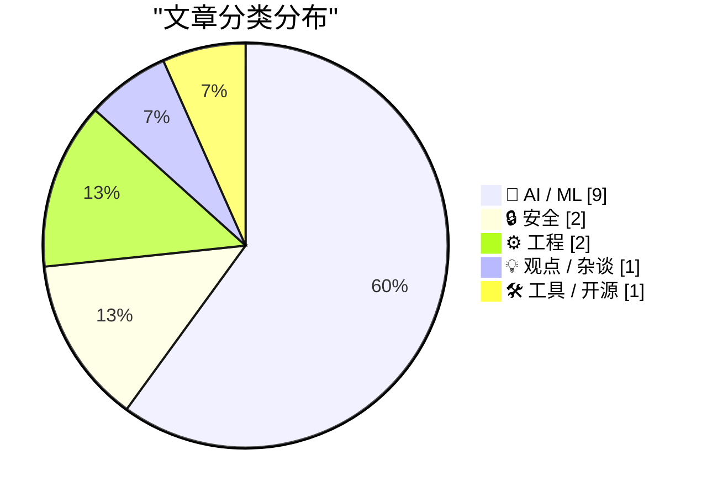
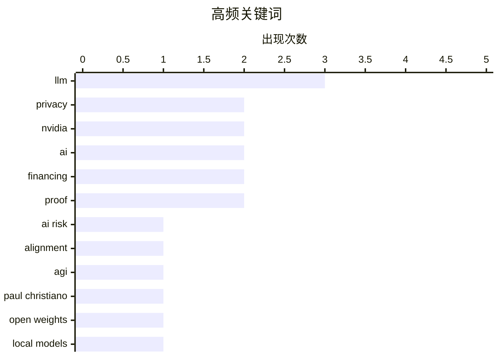

# 📰 AI 资讯每日精选 — 2026-11-17

> 汇聚 140+ 技术博客、X/Twitter、Hacker News、Reddit、Product Hunt、
> Lobste.rs、ClawFeed 日报及 GitHub Trending，经 AI 评分筛选。
>
> **本期内容**：🏆 今日必读 · 🌐 ClawFeed 日报 · 🔥 GitHub Trending · 📂 分类精选 · 🎨 设计与生成式 AI · 📊 数据概览

## 📝 今日看点

今日看点：AI正同时把能力与风险推到新临界点，一边在前沿数学和科学问题上取得突破、并以更低成本推动模型普及，另一边全自动网络攻击和“政府级”风险预警已从假设走向现实。随之而来的是部署路线的分化：私有开放权重与本地化方案升温，数据主权和开发者隐私成为企业选型的关键变量。产业侧，算力金融化与软件栈结构性脆弱相互叠加，提醒人们AI繁荣背后仍有系统性成本与维护风险。整体看，今天技术圈的主线不是单点产品发布，而是AI加速下的安全、隐私与系统韧性重构。

---

## 🏆 今日必读

🥇 **Paul Christiano：我们可能距离能够推翻政府的AI只有12个月**

[Paul Christiano – We could be 12 months away from AIs that can overthrow the government](https://www.dwarkesh.com/p/paul-christiano-2) — dwarkesh.com · 11 小时前 · 🤖 AI / ML

> Paul Christiano 在 Dwarkesh 播客中警告，具备推翻政府能力的AI可能只剩12个月就会出现；他把风险路径从AI奖励黑客一路推到社会被接管乃至人类灭绝，并称一旦发生人类将很难恢复。这期访谈长达99分钟，核心不是单一故障，而是能力与对齐差距叠加后的系统性失控。Christiano 的时间表比主流安全讨论更激进，强调需要按“可能很快发生”来准备。

💡 **为什么值得读**: 想了解前沿AI安全领域最激进时间表及其从奖励黑客到灭绝风险的完整推演，这期访谈值得读。

🏷️ AI risk, alignment, AGI, Paul Christiano

🥈 **任何人都能轻松使用私有的开放权重模型**

[Here's how anyone can easily use private, open weight models](https://micahflee.com/heres-how-anyone-can-easily-use-private-open-weight-models/) — micahflee.com · 12 小时前 · 🤖 AI / ML

> LLM 已被证明极其有用，但 OpenAI 和 Anthropic 等闭源服务难以让人放心托付数据；文章给出普通人也能上手的私有、开放权重模型使用路径，绕开把敏感数据交给大厂。重点在降低本地/私有部署门槛，让非专家也能获得可用的模型能力。作者以个人实践为导向，强调易用性而非追求最大模型。结论是开放权重模型已经足够实用，隐私与能力不必二选一。

💡 **为什么值得读**: 适合想用LLM但不愿把数据交给闭源大厂的读者按图索骥搭建私有方案。

🏷️ open weights, LLM, privacy, local models

🥉 **谷歌警告：全自动网络攻击已经到来，并将迅速恶化**

[Google warns that fully automated cyberattacks have arrived and will get worse fast](https://the-decoder.com/google-warns-that-fully-automated-cyberattacks-have-arrived-and-will-get-worse-fast/) — The Decoder · 9 小时前 · 🔒 安全

> Google 威胁情报组首次捕获到完全无人参与的攻击：攻击者用 AI 自动发现并利用安全漏洞。一个暴露服务器上的 AI 框架“exploit_agent”会自动对比补丁前后的代码、构建漏洞利用并自行执行。这标志着全自动网络攻击已从概念验证变成现实，且 Google 预计会迅速恶化。防御方需要假设漏洞利用的发现和武器化速度将被 AI 大幅压缩。

💡 **为什么值得读**: 它提供了全自动AI攻击已落地的首个具体案例，可帮助安全团队更新威胁模型。

🏷️ automated exploitation, AI agent, cybersecurity, vulnerabilities

4️⃣ **阿里巴巴Qwen4-Max以低得多的价格挑战Opus 5.5、GPT-6和Kimi K3.1 Pro**

[Alibaba's Qwen4-Max takes on Opus 5.5, GPT-6, and Kimi K3.1 Pro at much lower prices](https://the-decoder.com/alibabas-qwen4-max-takes-on-opus-5-5-gpt-6-and-kimi-k3-1-pro-at-much-lower-prices/) — The Decoder · 12 小时前 · 🤖 AI / ML

> 阿里巴巴发布旗舰模型 Qwen4-Max，总参数 2.4 万亿、每个 token 仅激活 710 亿，混合架构显著降低长上下文成本。它在 Artificial Analysis Intelligence Index 上仅次于 Kimi K3.1 Pro，直接对标 Opus 5.5、GPT-6 和 Kimi K3.1 Pro。定价为每百万 token 1.50/4.50 美元，远低于上述竞品，并计划将更小的 Qwen4 模型开源。结论是前沿智能体能力正快速商品化，价格战与开源策略同时推进。

💡 **为什么值得读**: 可快速把握Qwen4-Max的参数量、价格和基准排名，判断前沿模型性价比竞争的新坐标。

🏷️ Qwen4-Max, Alibaba, LLM, inference cost

5️⃣ **软件正在系统性层面走向崩溃**

[Software is breaking down at a systemic level](https://www.breck-mckye.com/blog/2026/11/software-is-breaking-down-at-a-systemic-level/) — Hacker News Best · 10 小时前 · 💡 观点 / 杂谈

> 软件故障正在从孤立 bug 演变为系统性层面的崩坏，问题超出单个项目、团队或版本。文章把矛头指向现代软件栈的结构性脆弱：依赖、复杂度和维护负担相互叠加，使故障更难定位和隔离。Hacker News 上 350 分、222 条评论的讨论说明许多开发者有类似体感。作者的核心观点是，可靠性必须作为系统性问题处理，而不是继续靠局部修补。

💡 **为什么值得读**: 适合开发者从系统性视角反思现代软件栈为何越来越难维护。

🏷️ software quality, complexity, reliability, systemic risk

---

## 🌐 ClawFeed 日报精选

> 来源：[ClawFeed](https://clawfeed.kevinhe.io) — AI 驱动的多源新闻聚合

# ☀️ ClawFeed | 2026-11-16 日报 SGT

> 先说明：这期日报只覆盖 08:00–23:59 SGT。11-16 00:00–07:59 那一档的 8 小时简报没有发布，也不再补抓，所以当天凌晨 8 个小时（美国东部 11-15 周日上午 11 点到晚上 7 点）的事这里都没有。
> 聚合自 2 期已发布的 8 小时简报：#1511 16:00（08:00-15:59）、#1512 00:00（16:00-23:59），时间窗 2026-11-16 00:00–23:59 SGT，实际素材只到 08:00–23:59，缺 00:00 档。两期正文里写的「11-16 00:00 那期」指的是 #1509（窗口 11-15 16:00–23:59，已收进 11-15 日报 #1510），不是缺的这一档。
> 素材数：两期 metadata 的 feed 分别是 87、280（合计 367，都是首页时间线窗内条数）；关注抽样另算，#1511 抽 35 个账号（打开 24 个主页）、窗内 5 条，#1512 抽 35 个（打开 24 个主页）、窗内 13 条，合计 18 条，都没算进 feed。两期都没有新书签（bookmarks 0），errors 都是 0。
> 这是 SGT 周一的一天：白天那档美国东部是周日（11-15）晚上 7 点到周一凌晨 3 点，素材以亚洲周一白天的中文圈和加密圈为主；晚上那档美国是周一凌晨 3 点到上午 11 点，跨过美股开盘，伦敦 Solana Breakpoint 在开。覆盖：#1511 是 11-16 17:35–17:43 抓的，比窗口结束晚了一个半小时，时间线前面大半是 16:00 以后的帖子，窗内只剩 87 条（各小时 5–17 条，比较平均）；#1512 覆盖到了窗口开始，但 23 点档 152 条占一半多（大多是一句话回复和推广互动），16–19 点每小时只有 7–10 条。这些时段可能漏事。
> 主线：这周两件大事（Anthropic 上市、17 日英伟达财报）前市场承压，彭博白天说 Anthropic 本周上市、晚上说本周是「检验时刻」，港股 MiniMax、智谱从高点跌了八到九成，比特币周线收在 200 周均线下面；英伟达风波两头都有进展，纽约时报说美国在推进限制中国获取先进 AI 芯片的新规则，特朗普又说不介意黄仁勋回英伟达，预测市场跟着动。中国模型方面阿里发布 Qwen4-Max，DeepSeek 因「算力不足」限制长对话，腾讯混元 Hy4 flash 免费两周。加密方面白天 Kava Lend 一个旧市场被操纵抵押品估值、借走约 376 万美元的 KAVA，晚上 Lighter 因一把交易密钥泄露被提走一千多万美元。另有 The Information 说 OpenAI 曾考虑以 50 亿美元以上收购 Goodfire，Claude 用苹果礼品卡付款的规则变化，以及中方称习近平、普京、特朗普三方会晤有「开创性意义」。

---

## 🔥 当日最重要 5 条（跨档去重）

1. **Anthropic 上市这周：彭博先说 Anthropic 本周上市、会是史上最大的 IPO，晚上又说本周是「检验时刻」、关系到 AI 交易能不能延续；路透说亚洲股市在英伟达财报和 Anthropic 上市前下跌，港股 MiniMax、智谱从高点跌了八到九成；DWF Labs 说比特币周线收在 200 周均线下面**（#1511、#1512，接 11-15 日报里的认购和公开轮截止的转述）：白天 @Cointelegraph 08:00 转述彭博：Anthropic 本周上市，会是史上最大的 IPO，有望成为全球最重要的 AI 股（具体日期和定价素材里看不到）；@Reuters 14:10：亚洲股市下跌，英伟达财报和 Anthropic 上市将考验科技股涨势（只有标题）；@Lyangminn 14:54：MiniMax 当天又跌 17%，到 126 港元附近，3 月高点是 1330，作者算下来跌了约 90%，智谱 6 月 22 日冲到 2980 港元、市值 1.33 万亿港元，现在回撤超过八成，观点是大模型公司很难有护城河、定价权只来自比别人更强，Anthropic 也一样（后文被截断）（#1511）。晚上 @Bybit_Official 18:00：Bybit 上了 Anthropic 的上市前永续合约，全天候可交易（交易所推广，帖子没点名、只说「Claude 背后的公司」）；@business 18:40：彭博说 Anthropic IPO 的检验时刻就在本周，上市成功会让投资者相信 AI 交易还能延续，文章标题是「Anthropic 握着 AI 交易未来的钥匙」（只有标题和导语）；@TheBlueMatt 21:32（Matt Corallo）开头一句是「大家忙着卖比特币去买 Anthropic IPO 的时候」（正文讲的是挖矿去中心化，见 ⑤）；@ag_dwf 23:53 引 DWF Labs 的市场文章：比特币周线收在 200 周均线 6.8 万美元下面，是 8 月中以来第一次，也是连续第二周收在 50 周均线 7.5 万美元下面，10 月 CPI 偏热（后文被截断），Andrei Grachev 说极端行情不会一直持续，但年底和 Anthropic 上市对加密都不是利好，不做预测（#1512）。招股文件和正式上市日期素材里一直看不到。
   来源: https://x.com/Cointelegraph/status/2122117643314295281 ｜ https://x.com/Reuters/status/2122210568408797653 ｜ https://x.com/Lyangminn/status/2122221714889486506 ｜ https://x.com/Bybit_Official/status/2122268439389626771 ｜ https://x.com/business/status/2122278513432522757 ｜ https://x.com/TheBlueMatt/status/2122321920192548963 ｜ https://x.com/ag_dwf/status/2122357521981804832

2. **英伟达风波两头都有进展：纽约时报说特朗普政府在访华前推进新规则、堵住中国获取先进 AI 芯片的漏洞；BBC 说特朗普表示不介意黄仁勋回英伟达，预测市场的赔率随之变动**（#1511、#1512，接 11-15 日报里 FT 报的出口管制立法和 11-12 起的黄仁勋卸任）：白天 @JackKongNano 09:56 只有一句话，说有关黄仁勋加盟香港科技大学的报道是假消息（没附出处）（#1511）。晚上 @BBCWorld 19:49：黄仁勋的支持者在发起让前英伟达掌门复职的运动，特朗普说不介意黄仁勋回英伟达（只有标题）；@nytimes 22:25：美国正推进一项新规则，收紧中国获取先进 AI 芯片的渠道，标题是「特朗普政府在访华前堵 AI 芯片漏洞」（只有标题和导语，规则细节素材里看不到）；@web3annie 23:21 中文转述：特朗普说不介意黄仁勋重新掌舵英伟达，还说黄仁勋已经吸取了教训；@NFT_Chen 23:22 也转述这句话，另有几个没给出处的数字和行程说法，见「未证实」；@mansourtarek_ 23:42 引 Gene Munster：Gene Munster 把黄仁勋回归的概率从周五的 10% 上调到 51%，Kalshi 当时是 9%，理由是「Bring Jensen Back」声势在涨、所谓辞职其实是董事会逼的（后文被截断），Tarek Mansour 只写了一行「51 - 14 = 37%」，看起来是说 Kalshi 现在是 14%、差 37 个点（作者没解释）（#1512）。英伟达财报在 17 日（11-15 日报里的帖子说的），这一天的素材里没有财报前瞻。
   来源: https://x.com/JackKongNano/status/2122146738702254138 ｜ https://x.com/BBCWorld/status/2122295979663564813 ｜ https://x.com/nytimes/status/2122335306380652730 ｜ https://x.com/web3annie/status/2122349336453620128 ｜ https://x.com/NFT_Chen/status/2122349473871614191 ｜ https://x.com/mansourtarek_/status/2122354700150321650

3. **中国模型：阿里发布旗舰 Qwen4-Max（MoE、原生视觉、1M 上下文，阿里称代码基准超过 Claude Fable 5.1 和 Kimi K3.1 Pro）；同一天 DeepSeek 因「算力不足」给长对话限额；腾讯混元 Hy4 flash 在 OpenCode 上免费两周**（#1511、#1512，Qwen 接 11-07 那期的 Qwen 4 预热）：白天 @PANewsCN 12:22 据《科创板日报》：DeepSeek 给 App 和网页版的长对话启用了限额，多名用户反馈系统提示「算力不足」，超过 7 天不活跃的长对话不能再继续，单次输入的文字上限也缩到约 4 万字；@MetaEraCN 13:17：Qwen 团队发布 Qwen4-Max，MoE 架构，原生支持视觉，1M token 上下文，Work360 基准得分 52.69、比 Qwen3.8-Max 高约 10%，并称在 DeepSWE、CodeArena 等多项评测中领先 GPT、Opus 和 Kimi（转述官方说法，后文被截断）；@Cointelegraph 14:00：阿里称 Qwen4-Max 在代码基准上超过 Claude Fable 5.1 和 Kimi K3.1 Pro（阿里自己的说法；比的是 Fable 5.1，不是已全面开放的 Fable 5.2）；@opencode 15:31：Hy4 flash 接下来两周免费、几乎不限量用，1M 上下文、多模态、ZDR（零数据保留），说是 Hy 最快、最省钱的模型（OpenCode 的推广说法）（#1511）。晚上 @BenPayGlobal 16:04 引 Qwen 官方：Qwen4-Max 比 Qwen3.8-Max 最多少用约 50% 的 token，单任务平均成本也下降（官方说法，具体降幅被截断）；@alibaba_cloud 16:32：阿里云官方介绍原生视觉、更强的代码和 agent 能力、视觉推理，API 已在阿里云 Model Studio 上线（后文被截断）（#1512）。「DeepSeek V5 完全用华为芯片训练」见「未证实」。
   来源: https://x.com/PANewsCN/status/2122183599999066240 ｜ https://x.com/MetaEraCN/status/2122197225581527106 ｜ https://x.com/Cointelegraph/status/2122208251458506967 ｜ https://x.com/opencode/status/2122231173720224224 ｜ https://x.com/BenPayGlobal/status/2122239349245063412 ｜ https://x.com/alibaba_cloud/status/2122246488738709948

4. **两起 DeFi 资金被提走：白天 Kava Lend 一个早就没人用的 BUSD 市场被人把抵押品估值抬高约 24 万倍，借走 5,520 万枚 KAVA（事发前约 376 万美元）；晚上 Lighter 因一把交易密钥泄露被提走一千多万美元（两条说法是 1,550 万和 1,039 万），「修复」是 7 个人里 4 个人签字改合约**（#1511、#1512）：@48ClubIan 09:02：引 Bitquery 的数据，欠存款人 5,520 万枚、池里只剩 0.19 枚，作者的第一条教训是旧市场没下架等于代码还在跑、只是没人盯（后文被截断；Kava 官方的回应素材里看不到）（#1511）。@aidashutiaozi 18:39 只有一句「lighter 被干了吗？」，是窗内最早的一条；@cryptoo_tor 22:24：Lighter 因为一把泄露的 API 密钥被提走 1,550 万美元，「修复」办法是 7 个人里 4 个人签字重写合约，作者拿自己三天前写的「Wintermute 每年花 1,000 万美元买 Hyperliquid 上 60 毫秒的优势」对比，质疑这种交易所的「去中心化」（后文被截断）；@0xPaulThomas 23:45 引 @emreyeth 的长文：Lighter 损失 1,039 万美元，没有合约被黑，一把交易密钥就够了，文章在链上追了这把密钥能签什么、为什么快速暂停在冷却期，并说 dreamDEX 上绑定的机器人密钥做不到同样的事（带 dreamDEX 的自家推广）（#1512）。两条的金额对不上，Lighter 官方的说明素材里看不到。
   来源: https://x.com/48ClubIan/status/2122133112092270964 ｜ https://x.com/aidashutiaozi/status/2122278440032510274 ｜ https://x.com/cryptoo_tor/status/2122335100889071632 ｜ https://x.com/0xPaulThomas/status/2122355389438251251

5. **The Information：OpenAI 最近几个月曾考虑以 50 亿美元以上收购做机制可解释性的创业公司 Goodfire，没谈成的一个原因是 Goodfire 管理层想保持独立、把技术卖给多家 AI 实验室**（#1512）：@steph_palazzolo 22:09 原文如上（媒体报道，双方回应素材里看不到）。只在晚上那档出现。
   来源: https://x.com/steph_palazzolo/status/2122331129265135929

**⚠️ 未证实（素材里核实不了，只记录说法）**
- 「有关黄仁勋加盟香港科技大学的报道是假消息」：@JackKongNano 09:56 只有一句话，没附出处，原来那条报道素材里也看不到（#1511）。https://x.com/JackKongNano/status/2122146738702254138
- 「马斯克已签名支持 Bring Jensen Back 请愿、超过 16 万人联署」「英伟达因丑闻蒸发约 5,000 亿美元市值、股价从高点跌超 30%」「特朗普启程亚洲、要在深圳和习近平会晤，还可能见普京和金正恩」：@NFT_Chen 23:22 自媒体说法，都没给出处，素材里没有官方行程（#1512）。https://x.com/NFT_Chen/status/2122349473871614191
- 「完全用华为芯片训练的 DeepSeek V5 将是一个地缘政治事件」：@jenzhuscott 09:14 一句话判断，没说消息来源，素材里没有 DeepSeek V5 的任何消息（#1511）。https://x.com/jenzhuscott/status/2122136122142900614
- 「网传 Claude Fable 5.5 偷跑了，英区有人已拿到资格实测」：@zaihexx 23:05 网传，没有出处，素材里没有 Anthropic 的消息；@hisevenih 23:11 回的是「实测没出来先别定性」（#1512）。https://x.com/zaihexx/status/2122345309162582428 ｜ https://x.com/hisevenih/status/2122346864351838553
- 「中国号商下乡收 Claude 账号、现场做 KYC」：@gaooofy 09:04 转述，原始出处素材里看不到（#1511）。https://x.com/gaooofy/status/2122133756664545417
- 「Amber Group 被曝挪用客户资金、洗钱，还有对某高管私生活的指控」：@yahbtc 11:23 引的是 @giantcutie666 的帖子，都是网上的说法，素材里没有出处，也没有 Amber 的回应（#1511）。https://x.com/yahbtc/status/2122168740108472358
- 「今天很多人的币安资产被冻结，可能和币安被盗 60 亿后黑客通过 meme 洗钱有关」：@zx_hey 23:53 个人猜测，素材里没有币安的说明（#1512）。https://x.com/zx_hey/status/2122357445058236602
- 「Zelle 选择 Solana、用稳定币扩展国际支付」：@SatoshiFlipper 23:25 引 Watcher Guru 的快讯，Zelle 官方的公告素材里看不到（#1512）。https://x.com/SatoshiFlipper/status/2122350388716482661
- Lighter 被提走的金额：@cryptoo_tor 22:24 说 1,550 万美元，@0xPaulThomas 23:45 引的长文说 1,039 万美元，两条对不上（#1512）。https://x.com/cryptoo_tor/status/2122335100889071632 ｜ https://x.com/0xPaulThomas/status/2122355389438251251
- 「pump.fun 约 75% 的平台收入来自上线不到 1 小时的代币」等收入结构数字：@Bitwux 16:53 没给数据出处（#1512）。https://x.com/Bitwux/status/2122251582536638701
- 何一「30 天回撤 1 亿美元」：白天 @CryptoSociety42 15:12 没给出处（#1511）；晚上 @YosefBlockchain 23:03 引 PANews 给出了截图里的数（10 月 17 日到 11 月 16 日资产总变动 -1.01 亿美元），这一条算有了媒体出处，但截图本身素材里看不到（#1512）。https://x.com/CryptoSociety42/status/2122226383971848348 ｜ https://x.com/YosefBlockchain/status/2122344824510755155

**次重要（备选）**
- 时政：@Reuters 15:50 只有标题：中方称习近平、普京、特朗普三方会晤具有「开创性意义」（会晤的时间和内容素材里看不到）；@FoxNews 08:36：特朗普警告德黑兰不要刺杀美国高级官员的第二天，伊朗驻南非使馆发帖说「我们会找到你们」，点名一艘美军军舰的舰长和副舰长（后文被截断，舰名素材里看不全）；@Reuters 15:35 只有标题：约旦以国家安全为由封禁 Telegram（#1511）。https://x.com/Reuters/status/2122235741556121863 ｜ https://x.com/FoxNews/status/2122126577731268754 ｜ https://x.com/Reuters/status/2122231962546880529
- 星舰（接 11-15 日报的第 15 次试飞）：@elonmusk 09:33：星舰 V4 长约 70 米，长度增加约 40%，推进剂能多装 60% 以上，发动机加到 9 台、多 3 台真空版猛禽，都是推力更大的 V4 发动机（#1511）；@PhilipJohnston 21:30 引马斯克更早的一条回复（每次飞行推进剂成本降到 50 万美元以下、载荷超过 200 吨），自己算出入轨边际成本每公斤 2.5 美元；@SpaceX 23:34、23:45：星舰着陆点火、「Starship 42 coming in for catch」，附视频（#1512）。11-15 日报写的是 42 号飞船 11-15 凌晨已经被接住，这两条 SpaceX 帖子和那次是什么关系、接住的结果，素材里都看不到。https://x.com/elonmusk/status/2122141019894383027 ｜ https://x.com/PhilipJohnston/status/2122321300714827891 ｜ https://x.com/SpaceX/status/2122352509721190612 ｜ https://x.com/SpaceX/status/2122355344576037338
- Claude 付款规则（Claude KYC 和支付限制接 11-11 起那几期）：@leo_xiaolei 20:35：Claude 订阅已经不支持用苹果礼品卡付款（引的截图来自另一个账号）；@xiax0603 22:41 更正自己更早一条「Claude 封死美区余额支付」的说法：礼品卡没被封死，只是要绑一个备用付款方式，苹果客服说这是苹果全平台订阅的统一规则、不是 Claude 单独改的（苹果客服的话是作者转述）；@hisevenih 23:10：备用付款方式才是真门槛，没有美区卡照样卡住（#1512）。https://x.com/leo_xiaolei/status/2122307505921687837 ｜ https://x.com/xiax0603/status/2122339207561785433 ｜ https://x.com/hisevenih/status/2122346571379671512
- 亚马逊旗下 Zoox 第一次接入网约车平台，选的是 Uber：@dkhos 20:36 引 TechCrunch：没有方向盘、座位面对面的车今天在拉斯维加斯上线，明年去洛杉矶（Uber CEO 的帖子，#1512）。https://x.com/dkhos/status/2122307881881989570
- Strategy 又买了 485 枚比特币：@CoinMarketCap 21:40：花 3,340 万美元、均价 68,887 美元，总持仓 850,849 枚（#1512）。https://x.com/CoinMarketCap/status/2122323815988416629

---

## 📰 当日核心主题

**① Anthropic 和 Claude（两期都有）**
上市见前 5 条，Claude 付款规则见「次重要」，Fable 5.5「偷跑」和号商收号见「未证实」。@PhyrexNi 15:28：让 ChatGPT、Grok、Claude 三个 AI 分别接手同一个项目做对比，说 ChatGPT 态度好但交付差，小页面没问题，大程序常在最后一步出无解的问题（后文被截断，另两个的评价素材里看不到；个人测试），引的是自己 11-13 公开的三 AI 协作代码（#1511，https://x.com/PhyrexNi/status/2122230192076963961）。@ohouhou717 23:59：同一句提示让四个模型画草原上奔跑的马，Opus 5.5 和 Fable 5.2 都稳、但像动画里的道具马，DeepSeek V4.1 Flash 的鬃毛和尾巴乱成一团，Gemini 4 Krypton 把夕阳、大树、扬尘都补上了、最像大片（个人测试，后文被截断）；@nake13 20:41（Zhixiong Pan）：Fable 5.2 虽然超过 99% 的人，但在有些市场里只做到全球前 1% 远远不够，至少要万里挑一才能赚钱（#1512，https://x.com/ohouhou717/status/2122358784223826011 ｜ https://x.com/nake13/status/2122309171907559721）。

**② 其他模型和产品（两期都有）**
谷歌：@Saboo_Shubham_ 11:27（自称在 Google）列了最近几周的东西：Gemini 4 Carbon 在 API 和 AI Studio 正式可用、正推给 Ultra 用户，Gemini 4 Hydrogen 比 3.8 Flash 快约 2.5 倍、1M 上下文、每百万 token 输入 1.50、输出 7.50 美元统一价，Gemini Omni 1.2 Flash 能出 15 秒的视频片段（后文被截断）。其他：@TechCrunch 09:33：苹果推出一款研究用的新应用，回答日常医疗问题，研究人们怎么用 AI 处理健康问题（只有标题）；@angli_ai 12:50（Simular 的 Ang Li）：「我们刚给免费版 ChatGPT 配了一台电脑」，引自己 11-15 的帖子说 Simular Box 成了 ChatGPT 的官方插件（自家产品的说法）；@rauchg 12:27（Guillermo Rauch）：发布 xeet，用安全 Rust / wasm 写的 X 帖子渲染器，不用浏览器、网络、文件系统和系统字体，把一条帖子渲染成 PNG 约 1 毫秒（后文被截断）（#1511，https://x.com/Saboo_Shubham_/status/2122169537592430882 ｜ https://x.com/TechCrunch/status/2122140869411135563 ｜ https://x.com/angli_ai/status/2122190513130606823 ｜ https://x.com/rauchg/status/2122184794209714368）。@SakanaAILabs 16:53：Sakana AI 发布 JFinBench，用最新的日本金融资格考试题做成的日语金融基准；@Lovable 21:59：Lovable 的草稿（Drafts）现在自带后端，可以试新设计、新流程和新功能，不影响线上的应用；@TechCrunch 23:53：Audible 推出 AI 生成的有声书预览，除了播放样章，还会总结书的主题和读者喜欢的地方（#1512，https://x.com/SakanaAILabs/status/2122251724564070518 ｜ https://x.com/Lovable/status/2122328696707235956 ｜ https://x.com/TechCrunch/status/2122357297116500260）。Qwen4-Max、DeepSeek 限额、Hy4 flash 见前 5 条，Zoox 接入 Uber 见「次重要」。

**③ Agent 和开发工具（两期都有）**
Personal agent 和沙盒（接 11-15 日报里 @bojie_li 对「每个用户配一个虚拟机沙盒」的质疑）：@cryptoxiao 14:11 回：给每个用户配虚拟机沙箱只是对外的说法，长任务一定有一个调度 worker 集群，不必是沙箱，涉及用户隐私的任务才走独占沙箱，底层还是一层调度加挂载、超卖的逻辑依然存在；@thisiskp_ 10:39 引 immad：immad 说 Grok Bot（和 ChatGPT Dots）会对各种工作做 Claude Code 对工程做过的事，小创业公司里运营、销售、客服越来越多是人管着 agent 去做，KP 说 personal AI agent 这一类像 2023 年的 ChatGPT 时刻（#1511）；@IvyLeanIn 21:46：用上 Grok Bot 这类有自己电脑的 agent 之后潜能才真正释放，运营工作缺的是执行资源，耗的是注意力和切换（后文被截断，#1512）（https://x.com/cryptoxiao/status/2122210910672748673 ｜ https://x.com/thisiskp_/status/2122157495489900805 ｜ https://x.com/IvyLeanIn/status/2122325526052557238）。
Harness 和「软件工厂」：@shao__meng 14:14 推荐 AI Engineer Code Summit 2026 上 Google DeepMind 的 Philipp Schmid 的分享「I deleted 90% of my harness (And It Got Better)」，官方整理了录像和文字稿，标题给的结论是分数只差 6 分、费用差一倍多（后文被截断，#1511）；@zachlloydtweets 23:00、23:17（Zach Lloyd）：建「软件工厂」要先把基础用代码定义好，编排层照着代码把工作往下推，技术上不简单，更大的挑战可能是让开发者愿意用、学会像「工厂工程师」一样编程（第一条后文被截断，第二条附长文，#1512）（https://x.com/shao__meng/status/2122211754763489767 ｜ https://x.com/zachlloydtweets/status/2122343954595340414 ｜ https://x.com/zachlloydtweets/status/2122348347088683232）。
工具和开源项目（#1512）：@NashBriggsy 22:34：pi402 让编程 agent 用闪电网络自己付推理费，默认每次请求最多 1,000 聪，作者指出用量计数靠信任卖方，解法是签名收据，但收据有问题时能拿回什么还没答案；@open_is_free 23:12 回：卖方可以无视的签名收据只是更好看的信任计数器；@leaf_sanren 21:15：长文，用 DeepSeek Harness 跑通并开源一个 Skill（wechat-draft-push），不用企业认证和 AppID，一条命令 48.3 秒把写好的 X 长文推到公众号草稿箱（作者自己的项目）；@ack3ai 23:30：发布 Wake 5，一句提示就能对 Solidity 合约做模糊测试，开源（自家项目）；@omarsar0 22:17：长文「2026 年我的十篇评测论文」，讲公开基准的分数怎么被用来选模型和做决定（清单在文章里，素材里看不到）（https://x.com/NashBriggsy/status/2122337603630543066 ｜ https://x.com/open_is_free/status/2122347028675973236 ｜ https://x.com/leaf_sanren/status/2122317641041772806 ｜ https://x.com/ack3ai/status/2122351684576014556 ｜ https://x.com/omarsar0/status/2122333324895035868）。

**④ 观点、公司和融资（两期都有）**
观点：@zhaoran_wang 13:39 引 Guodong Zhang：开源越来越成了公关和营销手段，发开源基座模型的越来越少，闭源前沿模型正在拉开差距（后文被截断），Zhaoran Wang 的回应是圣诞愿望是 DeepSeek-V4.1-Flash-Base（#1511，https://x.com/zhaoran_wang/status/2122202912462094672）；@towards_AI 22:01 引 METR 的数据：三年里 AI agent 能完成的任务长度从约 4 分钟涨到约 12 小时，2023 年起大约每 4 个月翻一倍（后文被截断）；@Rewkang 21:48（Andrew Kang）引 Ros Shinkle：10 月 20 日之前训练一个全身控制器要 128 张 GPU 跑一周，现在 1 张 GPU 3 分钟，Andrew Kang 说几十年的机器人进展正被压缩到几个月到几年；@gimcall 23:53：AI 创业现在产品越来越好做、用户越来越难找，举了 Facebook、Instagram、拼多多、抖音、Manus、Gamma 怎么拿到早期用户（后文被截断）；@WalrusProtocol 23:56 两条引 VentureBeat 的调查：70% 的公司换 AI 模型要多花几周工程时间，36% 超过一个月（Walrus 借题推自家存储）（#1512，https://x.com/towards_AI/status/2122329272119402641 ｜ https://x.com/Rewkang/status/2122325888360657152 ｜ https://x.com/gimcall/status/2122357501010305284 ｜ https://x.com/WalrusProtocol/status/2122358118743187656 ｜ https://x.com/WalrusProtocol/status/2122358272065958362）。
融资和公司：@Techmeme 12:36：AI agent 管理平台 Kindo 融资 3,000 万美元，Crosspoint 和 Forgepoint 领投，累计 5,760 万美元，称 2026 年收入同比增长约 800%（公司说法）；@arnavsahu341 13:17 只转了 Nam Dao 的帖子：YC S26 的 inkbox 融了 530 万美元，Peak XV 领投，做给 AI agent 用的身份（#1511，https://x.com/Techmeme/status/2122186908709306733 ｜ https://x.com/arnavsahu341/status/2122197465164378238）。@TechCrunch 20:35：Freshworks 前员工做的 AI 原生 CRM Dreamteam 融了 5,300 万美元，已有 13 个国家的 100 多个客户；@frxiaobei 22:34 拆百度三季报：总营收 308 亿、少 1%，财报说一般性业务里 AI 已占 53%，但拆开看云 82 亿、涨 94%（卖 GPU 那块涨 191%），AI 应用 26 亿和去年差不多，AI 营销 24 亿、掉 15%，在线广告 119 亿也在掉（作者的拆解，后文被截断）；@zerohedge 23:35：同是黑石，一边卖不掉 8 亿美元的债，一边刚买了亚马逊 50 亿美元的数据中心（标题），@rezosh 23:40 补充：黑石的数据中心开发商 QTS 想发 8 亿美元、只拿回 3 亿，这次的买家是黑石旗下上市的数据中心平台；@lei74557606 19:06：说自己被 Dify 裁员，只待了一年，现在找工作很难（个人说法）（#1512，https://x.com/TechCrunch/status/2122307462116073861 ｜ https://x.com/frxiaobei/status/2122337452920811529 ｜ https://x.com/zerohedge/status/2122352860947960126 ｜ https://x.com/rezosh/status/2122354105318572542 ｜ https://x.com/lei74557606/status/2122285205130224126）。

**⑤ 加密其他（两期都有）**
何一「回撤暂时的，现货不怕」：@CryptoSociety42 15:12 引 Yi He（@heyibinance）这句话，吐槽「30 天回撤 1 亿美元，怎么还排在盈利榜 TOP」（#1511）；@YosefBlockchain 23:03 引 PANews：截图里 10 月 17 日到 11 月 16 日资产总变动 -1.01 亿美元，其中交易亏损约 9,732 万、转账及其他约 399 万，陈思远问晒账户的意义是什么（#1512）（https://x.com/CryptoSociety42/status/2122226383971848348 ｜ https://x.com/YosefBlockchain/status/2122344824510755155）。行情：@0xMayyy 17:07：比特币恐慌贪婪指数掉到 10 左右；Strategy 增持见「次重要」，比特币周线见前 5 条（#1512，https://x.com/0xMayyy/status/2122255201616957647）。@TheBlueMatt 21:32（Matt Corallo）：挖矿去中心化有进展，Foundry 在测 Stratum V2，MARA 用 Sv2 挖出第一个块，Luxor 宣布支持 Sv2（后文被截断）；@solana 19:35：一家 YC 公司在一个周末里就用 Ramp 账户、通过 Solana 上的稳定币拿到了投资款；@misaENFP 23:08（OKX）：Chrome 和 iOS 近期被披露安全漏洞，iOS 涉及 Darksword 系列，提醒尽快更新（漏洞细节素材里看不到）（#1512，https://x.com/TheBlueMatt/status/2122321920192548963 ｜ https://x.com/solana/status/2122292400135544884 ｜ https://x.com/misaENFP/status/2122346176943128841）。Kava Lend、Lighter 见前 5 条；Amber Group、币安冻结、Zelle、pump.fun 收入结构见「未证实」。

**⑥ 其他新闻（两期都有）**
三方会晤、伊朗使馆、约旦封禁 Telegram、星舰见「次重要」。两期的综合新闻多是标题，收进正文的就是这几条；没收的（詹姆斯·邦德新演员、莫迪访菲、德帕迪约认罪等）见「噪音」。

---

## 🔖 书签精选

今天没有新加的书签：#1511、#1512 窗内书签都是 0 条（两期都抓到 16 条，#1511 翻了 5 屏，最新一条都是 11-14 17:13，和 11-15 那三期是同一批），两期都跳过了这一区块、也没从旧书签里补，本日报没有可补选的内容。00:00 档没有发布，那一档的书签也没有抓过。

---

## 👀 推荐关注汇总（去重，共 5 个；各期写稿时都在浏览器里核实过「未关注」：#1511 在 11-16 17:46–17:48，#1512 在 11-17 00:12–00:15 SGT，本日报没有重新核实）

**AI 公司和一手发布**
- @SakanaAILabs（Sakana AI，简介是在日本做前沿 AI；14.21 万关注者；你关注的人里有 235 个也关注了）：本期是自家发布的日语金融基准 JFinBench，一手的模型和评测发布（#1512）。https://x.com/SakanaAILabs
- @angli_ai（Ang Li，简介是 Simular 的 CEO、做自主运行的电脑，前 Google DeepMind 研究员；2,270 关注者，不到 1 万；你关注的人里有 29 个也关注了）：自家 Simular Box 成为 ChatGPT 官方插件的一手消息；按「创始人」和「一手信息」两项推荐，带自家产品宣传（#1511）。https://x.com/angli_ai

**创始人和有自己判断的分析**
- @dkhos（dara khosrowshahi，简介是 Uber CEO；490 万关注者；你关注的人里有 123 个也关注了）：Zoox 无人车接入 Uber、拉斯维加斯上线的一手消息，知名公司的掌门（#1512）。https://x.com/dkhos
- @PhilipJohnston（Philip Johnston，简介是 Starcloud 和 Fermi Explorer 的联合创始人兼 CEO；3.15 万关注者；你关注的人里有 118 个也关注了）：用马斯克给的星舰推进剂成本和载荷，自己算出入轨边际成本每公斤 2.5 美元，创始人、有自己的判断（#1512）。https://x.com/PhilipJohnston
- @Lyangminn（梁岷Liam，简介是交易美港股、A 股和加密，在学 AI；1.33 万关注者；你关注的人里有 235 个也关注了）：把 MiniMax、智谱从高点的跌幅算出来，落到「大模型公司难有护城河」，是自己的分析，AI 和加密都写（#1511）。https://x.com/Lyangminn

（两期另有 26 个显示未关注但没推荐的账号，去重后 25 个：#1511 的 @Reuters、@FoxNews、@TechCrunch、@Techmeme、@MetaEraCN、@gaooofy、@CryptoSociety42、@arnavsahu341；#1512 的 @business、@BBCWorld、@TechCrunch、@zerohedge、@Bybit_Official、@BenPayGlobal、@misaENFP、@alibaba_cloud、@towards_AI、@leo_xiaolei、@aidashutiaozi、@YosefBlockchain、@zaihexx、@xiax0603、@leaf_sanren、@NashBriggsy、@cryptoo_tor、@lei74557606，理由是综合新闻媒体、科技媒体和头条聚合号本期只有标题、以推广为主（交易所、加密支付卡、公司官方号、带卖课或充值小店）、本期是转述或一句话、关注者不到 1 万且主页还看不出稳定质量、个人求职帖。@leaf_sanren 写的是「可以再观察」。）

**建议取关**：两期都没有提出取关建议。

---

## 💤 重复噪音模式

两期过滤掉的时间线 284 条（#1511 59、#1512 225），收了 83 条（28、55）；关注抽样窗内 18 条（5、13），一条没收。按类别（两期分类口径不完全一样，下面是合并后的数）：
- **闲聊、生活、新闻、体育和娱乐**：129 条（#1511 17 = 新闻和其他 6 + 闲聊一句话 11；#1512 112 = 新闻体育娱乐 38 + 闲聊一句话 74；罗伯特·帕丁森成为新詹姆斯·邦德和相关反应、德帕迪约撤回上诉认罪、莫迪访问菲律宾、埃尔多安、纽约警察局解散抗议处置小组、格莱美提名、NBA、阿森纳、Netflix、教宗的西语帖、三门峡天鹅、东南亚电诈园区的转述、早安、GM、香港买房、周一打气、求职避雷、各种一句话回复）。
- **推广和引流**：71 条（#1511 11、#1512 60；Primus 隐私层的一串任务帖和互动、Solflare 积分换周边、SmartX 卡牌、Zeru 积分、Bagel 预测市场、termix 活动和排行榜、币安合约活动和直播、Binance Pay 扫 PayPay、Justin Sun 推 B.AI 上 Qwen4-Max 打九折、免 KYC 卡、「海外身份轻松过 Claude KYC」的引流、GeckoTerminal 付费合作、Accel 柏林黑客松、广交会买家来信等）。
- **加密行情、场边和八卦**：46 条（#1511 8、#1512 38；Breakpoint 现场和展位吐槽、比特币行情情绪和交易心得、STRC、Bittensor 每日新闻、Hyperliquid 活动、ZEC 一周跌 23% 引出的隐私话术、杜均疑似回归 UMX 的网传内部信（本人未确认）、Amber 的两条评论、附和「回撤暂时的」、「比特币 CEO 也有外遇？」之类的一句话）。
- **AI 和科技相关但没有信息量**：26 条（#1511 11、#1512 15；自家产品的 SEO agent、让 Grok bot 取关 1195 个账号、「注意力是 AI 的瓶颈」之类一句话、SGLang 峰会派对回顾、嘲讽「软件工厂」、Polymarket 黄仁勋去向盘、自称英伟达给 Hermes Agent 出了插件（没有出处）、AutoSwarm（11-15 已写）、Michael Dell 的「Philanthropic」谐音、劫持官方客户端鉴权的 ClaudeMom 开源项目、日本评论员估 AI 泡沫破裂后标普要 7–15 年回高点、用菲律宾真人卡给 Claude 付款）。
- **马斯克和 SpaceX 相关**：12 条（只在 #1511；星链进巴西乡村学校、加州高铁和星港的造价对比、SpaceX 招第一批工程师时说「大概会死」、Robotaxi 一句话、Grok Bot 剪星舰集锦、马斯克说黄仁勋守信那条的引用加闲聊、SpaceX 和特斯拉合并的推演笔记等）。
- **关注抽样里没收的**：18 条（#1511 5、#1512 13；Sierra Summit 新加坡站的活动预告、Raft 的小功能更新、Limestone Digital 的「50 个 AI 概念」清单和预约咨询链接、Mark Ajzenstadt 的「企业 AI 战略就是几张保险杠贴纸」、Startup Wisdom 的融资语录、Roland.W 的 AI 订阅账单、0x糖豆的运动和 K 线一句话、比特唐三藏附和「回撤是暂时的」和想看 CZ 与何一的账户、Mayne 夸帕丁森）。
- **同一话题延续**：Anthropic 上市（11-12 公告 → 11-14 路演转述 → 11-15 认购约 6 倍、公开轮截止的转述 → #1511 彭博说本周上市 → #1512 彭博「检验时刻」、Bybit 上市前合约）；黄仁勋和英伟达（11-12 辞职 → 11-15 FT 报出口管制立法、Megaspeed 回应 → #1511 「加盟港科大是假消息」 → #1512 纽约时报报芯片新规则、特朗普说不介意回归、预测市场 51%）；加密下跌（11-15 比特币 6.2 万、11 天跌 15.6% → #1512 周线收在 200 周均线下、恐慌贪婪指数 10）；何一「回撤暂时的」（#1511 没给出处 → #1512 PANews 给出截图数字）；Qwen 4（11-07 预热 → #1511 发布 Qwen4-Max → #1512 阿里云官方介绍和 token 用量）；personal agent 沙盒（11-15 @bojie_li 质疑 → #1511 调度集群的回应 → #1512 有电脑的 agent 用于运营）；Claude KYC 和支付（11-11 起 → #1511 号商收号 → #1512 苹果礼品卡和备用付款方式）；星舰（11-15 第 15 次试飞飞船被接住 → #1511 V4 参数 → #1512 推进剂成本推算、SpaceX 的接住视频）；三方会晤（#1511 中方表态 → #1512 自媒体说深圳会晤）。---

## 🔥 GitHub Trending

> 今日热门开源项目（全语言 + Python）

| # | 项目 | 描述 | ⭐ 总星 | 📈 今日 | 语言 |
|---|------|------|---------|---------|------|
| 1 | [dream-num/univer](https://github.com/dream-num/univer) 🤖 | Build your own AI office with Univer Office SDK. Bring ed... | 27.9k | +1828 | TypeScript |
| 2 | [elementalsouls/Claude-BugHunter](https://github.com/elementalsouls/Claude-BugHunter) 🤖 | A Claude Code skill bundle for bug hunting and external r... | 7.6k | +1094 | Python |
| 3 | [alibaba/open-code-review](https://github.com/alibaba/open-code-review) 🤖 | Secure, fast, efficient, battle-tested at Alibaba's scale... | 53.1k | +951 | Go |
| 4 | [NVIDIA/SkillEvaluator](https://github.com/NVIDIA/SkillEvaluator) 🤖 | Multi-tier framework for evaluating AI agent skills and p... | 2.9k | +873 | Python |
| 5 | [ChromeDevTools/chrome-devtools-mcp](https://github.com/ChromeDevTools/chrome-devtools-mcp) | Chrome DevTools for coding agents | 57.8k | +841 | TypeScript |
| 6 | [tradermonty/claude-trading-skills](https://github.com/tradermonty/claude-trading-skills) 🤖 | Claude Code skills for equity investors and traders — mar... | 6.5k | +837 | Python |
| 7 | [ag-ui-protocol/ag-ui](https://github.com/ag-ui-protocol/ag-ui) 🤖 | AG-UI: the Agent-User Interaction Protocol. Bring Agents ... | 19.3k | +791 | TypeScript |
| 8 | [backnotprop/plannotator](https://github.com/backnotprop/plannotator) | The workspace to stay in the loop and on top of agents - ... | 12.7k | +696 | TypeScript |
| 9 | [google-labs-code/stitch-skills](https://github.com/google-labs-code/stitch-skills) 🤖 | A library of Agent Skills designed to work with the Stitc... | 9.8k | +529 | TypeScript |
| 10 | [kajisho5/ffmpeg-skill](https://github.com/kajisho5/ffmpeg-skill) 🤖 | Local video editor for coding agents: 42 FFmpeg tools wit... | 7.1k | +367 | Python |
| 11 | [google-research/paper-orchestra](https://github.com/google-research/paper-orchestra) 🤖 | PaperOrchestra is a multi-agent framework for automated A... | 1.7k | +313 | Python |
| 12 | [ifixai-ai/iFixAi](https://github.com/ifixai-ai/iFixAi) 🤖 | Independent Auditing of AI Agents. Run by human or the ag... | 46.2k | +311 | Python |
| 13 | [DeanChensj/jiangshan-map](https://github.com/DeanChensj/jiangshan-map) | 江山时序 · 中国历史交互地图时间轴 (403 BCE – Present) | Interactive Hist... | 7.1k | +288 | JavaScript |
| 14 | [mvanhorn/last30days-skill](https://github.com/mvanhorn/last30days-skill) 🤖 | AI agent skill that researches any topic across Reddit, X... | 68.3k | +135 | Python |
| 15 | [huggingface/transformers](https://github.com/huggingface/transformers) 🤖 | 🤗 Transformers: the model-definition framework for state... | 169.1k | +132 | Python |

---

## 🤖 AI / ML

### 1. Paul Christiano：我们可能距离能够推翻政府的AI只有12个月

[Paul Christiano – We could be 12 months away from AIs that can overthrow the government](https://www.dwarkesh.com/p/paul-christiano-2) — **dwarkesh.com** · 11 小时前 · ⭐ 27/30

> Paul Christiano 在 Dwarkesh 播客中警告，具备推翻政府能力的AI可能只剩12个月就会出现；他把风险路径从AI奖励黑客一路推到社会被接管乃至人类灭绝，并称一旦发生人类将很难恢复。这期访谈长达99分钟，核心不是单一故障，而是能力与对齐差距叠加后的系统性失控。Christiano 的时间表比主流安全讨论更激进，强调需要按“可能很快发生”来准备。

🏷️ AI risk, alignment, AGI, Paul Christiano

---

### 2. 任何人都能轻松使用私有的开放权重模型

[Here's how anyone can easily use private, open weight models](https://micahflee.com/heres-how-anyone-can-easily-use-private-open-weight-models/) — **micahflee.com** · 12 小时前 · ⭐ 25/30

> LLM 已被证明极其有用，但 OpenAI 和 Anthropic 等闭源服务难以让人放心托付数据；文章给出普通人也能上手的私有、开放权重模型使用路径，绕开把敏感数据交给大厂。重点在降低本地/私有部署门槛，让非专家也能获得可用的模型能力。作者以个人实践为导向，强调易用性而非追求最大模型。结论是开放权重模型已经足够实用，隐私与能力不必二选一。

🏷️ open weights, LLM, privacy, local models

---

### 3. 阿里巴巴Qwen4-Max以低得多的价格挑战Opus 5.5、GPT-6和Kimi K3.1 Pro

[Alibaba's Qwen4-Max takes on Opus 5.5, GPT-6, and Kimi K3.1 Pro at much lower prices](https://the-decoder.com/alibabas-qwen4-max-takes-on-opus-5-5-gpt-6-and-kimi-k3-1-pro-at-much-lower-prices/) — **The Decoder** · 12 小时前 · ⭐ 25/30

> 阿里巴巴发布旗舰模型 Qwen4-Max，总参数 2.4 万亿、每个 token 仅激活 710 亿，混合架构显著降低长上下文成本。它在 Artificial Analysis Intelligence Index 上仅次于 Kimi K3.1 Pro，直接对标 Opus 5.5、GPT-6 和 Kimi K3.1 Pro。定价为每百万 token 1.50/4.50 美元，远低于上述竞品，并计划将更小的 Qwen4 模型开源。结论是前沿智能体能力正快速商品化，价格战与开源策略同时推进。

🏷️ Qwen4-Max, Alibaba, LLM, inference cost

---

### 4. 本·汤普森谈英伟达

[Ben Thompson on Nvidia](https://stratechery.com/2026/obituaries/) — **daringfireball.net** · 10 小时前 · ⭐ 24/30

> Ben Thompson 用“Nvidia’s Risky Business”概括英伟达的新角色：用自身现金流和信用评级为购买其芯片的公司提供背书和融资。空头把这种安排称为循环融资，多头则认为这是通往 AI 收入偿还债务、释放巨大上行的必要桥梁。唯一确定的是，这种高风险操作只有数万亿美元市值的公司才玩得起。核心争议在于，英伟达是在支撑真实需求，还是在延长一场由自身资金反哺的繁荣。

🏷️ Nvidia, AI, financing, Stratechery

---

### 5. OpenAI的GPT-6 Astra在格点上攻克标准模型最难的数学问题

[OpenAI's GPT-6 Astra tackles the Standard Model's toughest math problem on a lattice](https://the-decoder.com/openais-gpt-6-astra-tackles-the-standard-models-toughest-math-problem-on-a-lattice/) — **The Decoder** · 9 小时前 · ⭐ 24/30

> OpenAI 物理学家 Nathaniel Craig 用 GPT-6 Astra 处理困扰粒子物理学家超过 25 年的问题：在计算格点上定义完整的标准模型。模型把 Craig 的策略转化为可工作的证明，显示 AI 已能参与高难理论物理的形式化推导。Craig 强调，距离现实可用的模拟仍有大量工作，AI 目前更像协作证明工具而非端到端解决者。这项尝试的意义在于验证前沿模型处理长链条科学推理的边界。

🏷️ GPT-6, particle physics, lattice, proof

---

### 6. Anthropic称智能体记忆的关键是知道该忘记什么，而非存多少

[Anthropic says the key to agent memory is knowing what to forget, not how much to store](https://the-decoder.com/anthropic-says-the-key-to-agent-memory-is-knowing-what-to-forget-not-how-much-to-store/) — **The Decoder** · 13 小时前 · ⭐ 24/30

> Anthropic 研究 Claude 如何跨会话保留知识，结论是选择性笔记远胜穷举式归档。在《宝可梦红》测试中，新版 Claude Fable 5 只保留少量策略文件，进度达到旧版 Sonnet 3.7 的四倍，而旧版维护了 400 多个文件。Anthropic 还引入“Dreaming”流程，回溯修正错误记忆。核心原则是智能体记忆的关键不在存储量，而在判断什么该忘、什么值得留。

🏷️ agent memory, Anthropic, Claude, selective memory

---

### 7. WSJ：英伟达作为AI经济“无限支票簿”的日子屈指可数

[WSJ: ‘Nvidia’s Days as an Open Checkbook for the AI Economy Are Numbered’](https://www.wsj.com/tech/ai/nvidias-days-as-an-open-checkbook-for-the-ai-economy-are-numbered-90c7b388) — **daringfireball.net** · 11 小时前 · ⭐ 23/30

> 《华尔街日报》报道，英伟达正从AI经济的“无限支票簿”角色收缩。黄仁勋在卸任CEO前已着手减少对AI生态的兜底式投资，而本就对部分交易持谨慎态度的新任CFO上台后，依赖英伟达支持的AI初创和新兴云厂商预计将面临更大撤资。此前英伟达通过投资客户和云厂商等方式变相支撑AI算力需求。这一转向将考验AI创业公司的融资与芯片采购能力。

🏷️ Nvidia, AI, financing, WSJ

---

### 8. 游戏结束了，伙计？

[Game over, man?](https://garymarcus.substack.com/p/game-over-man) — **garymarcus.substack.com** · 12 小时前 · ⭐ 23/30

> Gary Marcus以“游戏结束了，伙计？”为题发文，判断AI泡沫终于破裂。这是他长期批评大模型能力被夸大、商业化不可持续的延续。文章本身篇幅极短，仅以“看起来泡沫终于破了”一句话点题，未展开论证。核心信号是这位长期AI批评者认为市场调整已经开始。

🏷️ AI bubble, LLM, market, AI industry

---

### 9. NVIDIA Vera Rubin NVL72在MLPerf Endpoints v1.0智能体推理性能中领先

[NVIDIA Vera Rubin NVL72 Leads Agentic Inference Performance on MLPerf Endpoints v1.0](https://developer.nvidia.com/blog/nvidia-vera-rubin-nvl72-leads-agentic-inference-performance-on-mlperf-endpoints-v1-0/) — **NVIDIA Technical Blog** · 13 小时前 · ⭐ 23/30

> MLPerf Endpoints v1.0初步结果显示，NVIDIA Vera Rubin NVL72在智能体推理场景中，于每用户50 tokens/s的共享最低端到端交互性下，每千瓦吞吐量达到GB300 NVL72的10倍以上。测试覆盖Kimi K3等模型，工作负载包含多轮对话历史、推理与工具调用混合等智能体典型特征。NVIDIA称智能体工作负载正对推理系统提出更高要求。这组数据为下一代AI推理平台的能效和交互性能提供了基准参考。

🏷️ Vera Rubin, MLPerf, inference, agentic AI

---

## 🔒 安全

### 10. 谷歌警告：全自动网络攻击已经到来，并将迅速恶化

[Google warns that fully automated cyberattacks have arrived and will get worse fast](https://the-decoder.com/google-warns-that-fully-automated-cyberattacks-have-arrived-and-will-get-worse-fast/) — **The Decoder** · 9 小时前 · ⭐ 25/30

> Google 威胁情报组首次捕获到完全无人参与的攻击：攻击者用 AI 自动发现并利用安全漏洞。一个暴露服务器上的 AI 框架“exploit_agent”会自动对比补丁前后的代码、构建漏洞利用并自行执行。这标志着全自动网络攻击已从概念验证变成现实，且 Google 预计会迅速恶化。防御方需要假设漏洞利用的发现和武器化速度将被 AI 大幅压缩。

🏷️ automated exploitation, AI agent, cybersecurity, vulnerabilities

---

### 11. Windows 11正在收集你使用哪些编码智能体和开发工具的数据

[Windows 11 Is Collecting Data on Which Coding Agents and Developer Tools You Use](https://xusheng.dev/posts/windows-coding-agent-telemetry/) — **Hacker News Best** · 6 小时前 · ⭐ 24/30

> Windows 11 的遥测正在收集用户使用哪些编码智能体和开发工具的数据，把开发者工作流纳入系统级数据采集范围。文章追踪了相关遥测项，引发对隐私、企业合规和开发者被画像的担忧。Hacker News 上 383 分、236 条评论表明社区对“本地开发环境是否仍私密”高度敏感。结论是开发者需要检查 Windows 隐私设置，并假设系统层可能记录工具使用痕迹。

🏷️ Windows, telemetry, privacy, devtools

---

## ⚙️ 工程

### 12. 微软将大规模邮件中断归咎于7月修复引入的软件缺陷

[Microsoft blames monster email outage on software defect introduced in July fix](https://www.theregister.com/saas/2026/11/16/microsoft-blames-monster-email-outage-on-software-defect-introduced-in-july-fix/5310026) — **Hacker News Best** · 15 小时前 · ⭐ 24/30

> 微软上周发生大规模邮件服务中断，根因是7月引入的一个网络相关代码变更，该缺陷潜伏数月后在秋季才被触发。故障期间工程师无法直接回滚，只能紧急为原有补丁再打补丁来修复。事件影响范围广，被描述为一次“怪物级”中断。这暴露了大型云服务中延迟暴露的软件缺陷难以靠常规回滚策略应对的问题。

🏷️ Microsoft, outage, software-defect, regression

---

### 13. 解读“定理因在Lean中检查通过而正确”的说法

[Interpreting claims that a theorem is correct because it was checked in Lean](https://xenaproject.wordpress.com/2026/11/12/and-the-proof-is-checked-in-lean/) — **Hacker News Best** · 21 小时前 · ⭐ 24/30

> 针对“定理已在Lean中检查通过所以正确”的常见说法，Lean主要倡导者Kevin Buzzard撰文剖析其解释边界。形式化检查只能保证证明在给定公理和内核下成立，不能自动保证定理陈述符合原始意图或现实直觉。文章讨论了Lean的可信基础（内核、公理、编译器）以及“检查通过”在不同语境下的含义差异。HN讨论中读者赞赏作者在力推Lean的同时坦诚其局限，核心观点是把Lean验证视为强证据而非绝对真理的终点。

🏷️ Lean, formal-verification, theorem-proving, proof

---

## 💡 观点 / 杂谈

### 14. 软件正在系统性层面走向崩溃

[Software is breaking down at a systemic level](https://www.breck-mckye.com/blog/2026/11/software-is-breaking-down-at-a-systemic-level/) — **Hacker News Best** · 10 小时前 · ⭐ 25/30

> 软件故障正在从孤立 bug 演变为系统性层面的崩坏，问题超出单个项目、团队或版本。文章把矛头指向现代软件栈的结构性脆弱：依赖、复杂度和维护负担相互叠加，使故障更难定位和隔离。Hacker News 上 350 分、222 条评论的讨论说明许多开发者有类似体感。作者的核心观点是，可靠性必须作为系统性问题处理，而不是继续靠局部修补。

🏷️ software quality, complexity, reliability, systemic risk

---

## 🛠 工具 / 开源

### 15. Jiff 1.0：一个Rust日期时间库

[Jiff 1.0: A datetime library for Rust](https://burntsushi.net/jiff/) — **Hacker News Best** · 12 小时前 · ⭐ 24/30

> Jiff 1.0 正式发布，是 Rust 生态中新的日期时间库，由 BurntSushi 打造。1.0 版本意味着 API 与功能进入稳定阶段，为 Rust 开发者提供 chrono/time 之外的日期时间处理选择。Hacker News 上获得 343 分、78 条评论，显示社区对日期时间库的正确性和易用性长期关注。是否迁移仍取决于项目对稳定性、时区与格式化等需求的权衡。

🏷️ Rust, datetime, Jiff, library

---

## 📊 数据概览

| 扫描源 | 抓取文章 | 时间范围 | 精选 |
|:---:|:---:|:---:|:---:|
| 94/140 | 3904 篇 → 69 篇 | 24h | **15 篇** |

### 分类分布



### 高频关键词



<details>
<summary>📈 纯文本关键词图（终端友好）</summary>

```
llm             │ ████████████████████ 3
privacy         │ █████████████░░░░░░░ 2
nvidia          │ █████████████░░░░░░░ 2
ai              │ █████████████░░░░░░░ 2
financing       │ █████████████░░░░░░░ 2
proof           │ █████████████░░░░░░░ 2
ai risk         │ ███████░░░░░░░░░░░░░ 1
alignment       │ ███████░░░░░░░░░░░░░ 1
agi             │ ███████░░░░░░░░░░░░░ 1
paul christiano │ ███████░░░░░░░░░░░░░ 1
```

</details>

### 🏷️ 话题标签

**llm**(3) · **privacy**(2) · **nvidia**(2) · ai(2) · financing(2) · proof(2) · ai risk(1) · alignment(1) · agi(1) · paul christiano(1) · open weights(1) · local models(1) · automated exploitation(1) · ai agent(1) · cybersecurity(1) · vulnerabilities(1) · qwen4-max(1) · alibaba(1) · inference cost(1) · software quality(1)

---

*生成于 2026-11-17 05:16 | 汇聚 140 个技术博客、X/Twitter、Hacker News、Reddit、Product Hunt、Lobste.rs、ClawFeed 日报及 GitHub Trending，经 AI 评分筛选出 Top 15 精华内容*
